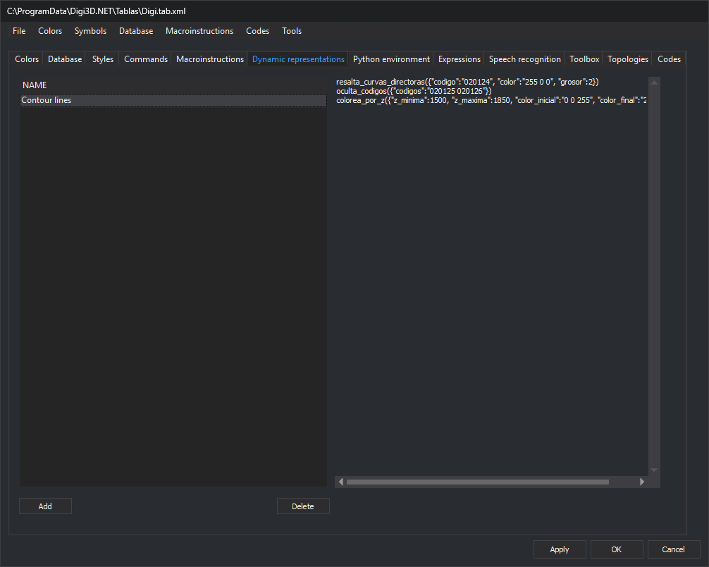
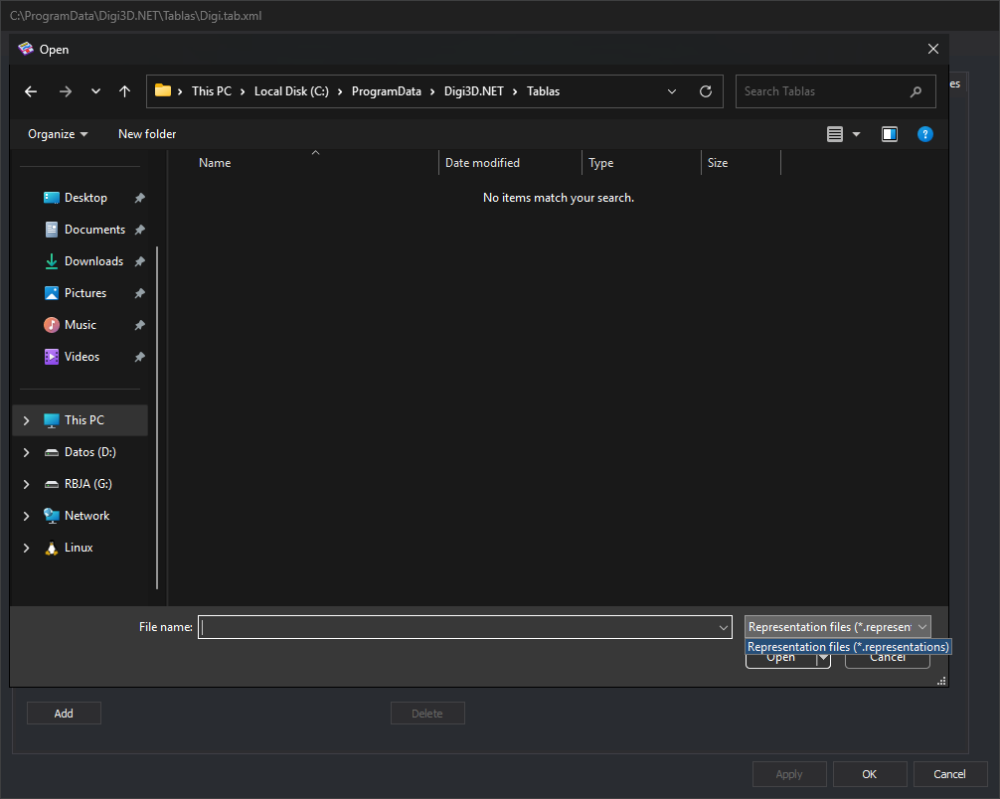

# Dynamic representations
<!-- id: representaciones-dinamicas -->
<!-- origen: 77ce91dd4726ccef7e4cb390ace348ae81acf005 -->

This tab saves dynamic representation rule lists in the code table. Each comes from a `.representations` file created with [ASSIGN\_REPRESENTATIONS](/digi3d-ai/referencia/ventana-de-dibujo/ordenes/a/asignar-representaciones.md).

Rules are Python functions in [Python environment](entorno-python.md) with the `@dynamic_representation_rule()` decorator. A `.representations` is a text file with one rule and its parameter values per line.

## Controls

* **Representation list** (**Name** column): one row per dynamic representation in the code table.
* **Contents**: read-only text box showing the selected representation's contents.
* **Add**: opens **Open** to select a `.representations`. Its filename without extension becomes the name; file text becomes its contents. If the name exists, its contents are replaced.

  
* **Delete**: deletes the selected representation. Enabled with a selected row.

To change a representation, edit the `.representations` file and add it again.

## Where they are used

With the code table active in the drawing window, its dynamic representation names appear under **View/Dynamic representations**. Selecting one applies its rule list to geometry rendering. [DYNAMIC\_REPRESENTATION](/digi3d-ai/referencia/ventana-de-dibujo/ordenes/r/representacion-dinamica.md) applies the named rule list supplied as its parameter.

Changes apply to the code table with **Apply** or **OK**.
