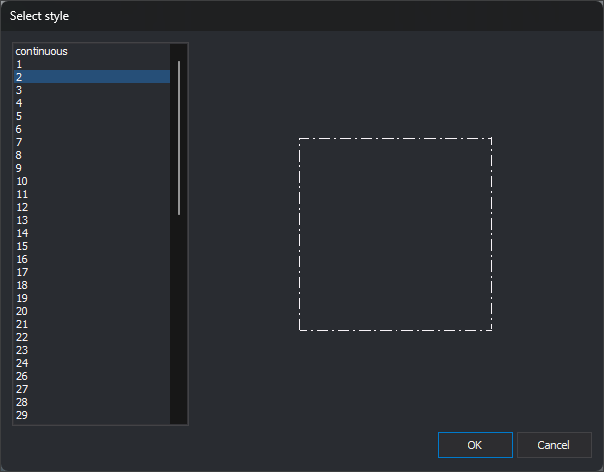

# Select style
<!-- id: selecciona-el-estilo -->
<!-- origen: de85c815f36b6135b82a4ac11a5e0591c4240045 -->

This dialog chooses one of the code table's [styles](estilos.md). Opened by:

* **Add** for representations in [Codes](codigos/README.md), adding a representation with the selected style to the code.
* **Delete** in [Styles](estilos.md), when a code uses the deleted style and a replacement must be chosen.
* **Tools/Tests/Codes/Codes with nonexistent styles**, to replace missing styles. See [Tests](../menus/herramientas/comprobaciones.md).
* **Codes/Import codes from ArcGIS workspace definition file...**, after [ArcGIS version](../menus/version-de-arcgis.md). Its title is then **Select the style to assign to the points**.

## Controls

* **Style list**: code table styles in **Styles** tab order. Initially the first is selected. Double-clicking is equivalent to selecting a style and clicking **OK**.
* **Preview**: to the right, draws a square with the selected style in the theme's text color.
* **OK**: closes with the selected style. Does nothing if none is selected.
* **Cancel**: closes without choosing a style.

The dialog is resizable: the list grows vertically and the preview in both directions. **OK** saves its position and size for next time.
