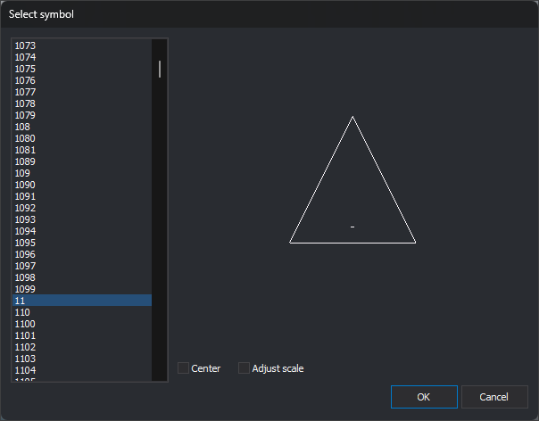

# Select symbol
<!-- id: selecciona-el-simbolo -->
<!-- origen: 197ab7c1d055650aef3f3f5e238bb3a0b5c22d9a -->

Opened by **...** in **Symbol** in [Styles](estilos.md). Chooses the style's symbol or texture.

## Controls

* **List**: alphabetical symbols (`.bin` drawing files) and textures (images in formats supported by Digi3D.AI) from the symbols folder configured under [Tools/Configuration...](../menus/herramientas/configuracion.md). Initially selects the style's current symbol. Double-clicking is equivalent to selecting an item and clicking **OK**.
* **Preview**: to the right, draws the selected symbol in the theme's text color. A texture is drawn over a gray-and-white checkerboard to reveal transparency.
* **Center**: places the symbol center at the preview center. When cleared, places its origin there.
* **Adjust scale**: scales the symbol so its longest side fills the preview. Scaling is relative to the preview center: with **Center** cleared, part may lie outside. A dimensionless symbol, such as text alone, is drawn without changing scale.
* **OK**: writes the selected symbol or texture name to **Symbol** in **Styles**. Does nothing if none is selected.
* **Cancel**: closes without changing the symbol.

**Center** and **Adjust scale** affect only the preview. Disabled for a texture and reenabled for a symbol. **OK** saves their states, dialog position and size for next time.

The dialog is resizable: the list grows vertically and the preview in both directions.
