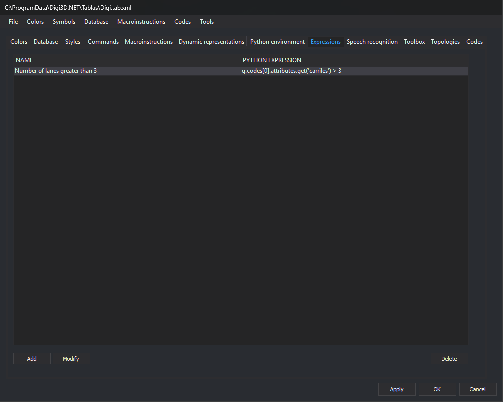

# Expressions
<!-- id: selecciones -->
<!-- origen: 64b58b2fab2b29fa76d3ebe63972d3bf7221e51d -->



This tab, **Expressions**, defines named selections. Each selection is a Python expression evaluated for each geometry in the drawing files. The program selects entities for which the expression is true.

Each selection has a **name** and an **expression**. The tab's list shows one row per selection, with **Name** and **Python expression** columns. Names must be unique: if you add a selection with an existing name, the editor displays a warning and does not add it.

## Buttons

| Button | Action |
| :--- | :--- |
| **Add** | Open the **New selection** dialog box to enter the name and expression. |
| **Modify** | Open the same dialog box with the selected row's name and expression. |
| **Delete** | Delete the selected row. |

**Modify** and **Delete** are enabled when you select a row. Changes on this tab are applied to the code table when you click **Apply** or **OK**.

## Where selections are used

Selections modify the Digi3D.AI interface. Selection names from the active code table appear as options in two menus:

* **View/(code table selections)**: run [ON\_ONLY\_PYTHON\_EXPRESSION](/digi3d-ai/referencia/ventana-de-dibujo/ordenes/o/on_solo_expresion_python.md) with the selection's expression.
* **Immediate/Select by Python expression.../(code table selections)**: run [SELECT\_PYTHON\_EXPRESSION](/digi3d-ai/referencia/ventana-de-dibujo/ordenes/s/selecciona_expresion_python.md) with the selection's expression.

[ON\_PYTHON\_EXPRESSION](/digi3d-ai/referencia/ventana-de-dibujo/ordenes/o/on_expresion_python.md), [OFF\_PYTHON\_EXPRESSION](/digi3d-ai/referencia/ventana-de-dibujo/ordenes/o/off_expresion_python.md), and [ON\_ONLY\_PYTHON\_EXPRESSION](/digi3d-ai/referencia/ventana-de-dibujo/ordenes/o/on_solo_expresion_python.md) also accept a selection name as a parameter, preceded by `#`:

```text
ON_PYTHON_EXPRESSION=#Edificios
```

## The expression

* This is a single Python 3 expression, not a script: `import`, assignments, and blocks are not allowed. Python 3 does not support the `<>` operator: use `!=`. To read the first code's text, replace the .NET name `g.Codes[0].Name` with `g.codes[0].code` from the [Python application programming interface (API)](/digi3d-ai/programacion/python/referencia/digi21.base/geometry.md).
* The variable `g` contains the geometry being evaluated. It is a [Geometry](/digi3d-ai/programacion/python/referencia/digi21.base/geometry.md) object whose concrete type is `Point`, `Text`, `Line`, `Polygon`, or `Complex`.
* No variable is created for each database attribute. The first code's attributes are in the `g.codes[0].attributes` dictionary (field name → value). To read a field, use `g.codes[0].attributes.get('campo')`, which returns `None` if the field does not exist.
* The expression must return `True` or `False`. `None` (false) or a number (true if nonzero) is also accepted. A string, list, or other type produces an error.
* The expression can use Python built-in functions (such as `len` or `type`) and names defined by the code table's [Python environment](/digi3d-ai/referencia/editor-de-tablas-de-codigos/pestanas/entorno-python.md), including its functions. If evaluating the expression accesses a name not defined in the `__main__` module (the variable `g` and environment names) or among Python's built-in names, Python raises a `NameError`. To use `Text` without the `digi3d.` prefix, the environment must import that name with a line such as `from digi3d import Text`. The [ON\_PYTHON\_EXPRESSION](/digi3d-ai/referencia/ventana-de-dibujo/ordenes/o/on_expresion_python.md#the-expression) page details which names the expression can use.

| Expression | Meaning |
| :--- | :--- |
| `g.codes[0].code` | First code of the geometry. |
| `g.has_code('02*')` | The geometry has a code matching the pattern. Supports `*` and `?` wildcards. |
| `len(g)` | Number of vertices. |
| `g[0]` | First vertex coordinates `(x, y, z)`. |
| `type(g).__name__` | Geometry type: `'Point'`, `'Text'`, `'Line'`, `'Polygon'`, or `'Complex'`. |
| `g.area`, `g.perimeter_2d` | Area and plan perimeter. Only for lines and polygons. |
| `g.closed` | Whether the geometry is closed. Only for lines, polygons, and complex geometries. |
| `g.text` | Text string. Only for text geometries. |

If the expression fails for any geometry, such as `g.area` for a point, Digi3D.AI displays the Python error. Check the type of `g` before reading `g.area`: `type(g).__name__ == 'Line' and g.area > 100`. The [Errors](/digi3d-ai/referencia/ventana-de-dibujo/ordenes/o/on_expresion_python.md#errors) section of ON\_PYTHON\_EXPRESSION describes what happens when the expression fails.

## New selection dialog box

The dialog box has these controls:

* **Name**: selection name.
* Field after `return`: Python expression.
* **Code snippets** and **Add snippet**: append the snippet chosen in the drop-down list to the expression.

The drop-down list offers operators (`==`, `!=`, `<`, `>`, `<=`, `>=`, `and`, `and not`, `not`, `True`, `False`) and these snippets for the geometry `g`:

| Snippet | Meaning |
| :--- | :--- |
| `type(g).__name__ == 'Point'` | Check the geometry type. There is one for each type: `Point`, `Line`, `Text`, `Polygon`, and `Complex`. |
| `g.has_code('code')` | The geometry has a code matching the pattern. |
| `len(g)` | Number of vertices. |
| `g[0]` | First vertex coordinates. |
| `g.codes[0].attributes.get('field')` | Value of a database field of the first code. |
| `g.area` | Area. |
| `g.perimeter_2d` | Plan perimeter. |
| `g.closed` | Whether the geometry is closed. |
| `g.text` | Text string. |

Replace `code` and `field` with the code or field you need.

## Examples

All entities:

```python
True
```

The expression is evaluated for each geometry and always returns true, so it selects all entities.

Entities whose first code is `020400`:

```python
g.codes[0].code == '020400'
```

Entities with 3 vertices:

```python
len(g) == 3
```

Entities whose `Plantas` field equals 3:

```python
g.codes[0].attributes.get('Plantas') == 3
```

Combined conditions:

```python
g.codes[0].attributes.get('Propietario') == 'Dylan' and g.codes[0].attributes.get('Plantas') > 3 and g.codes[0].code == '010101' and len(g) == 7
```
