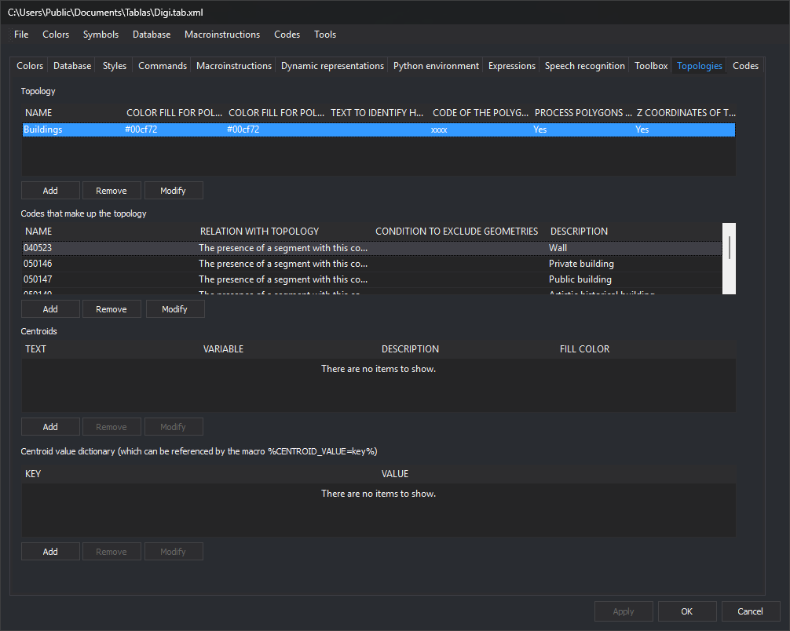

# Topologies
<!-- id: topologias -->
<!-- origen: d2412c9c9a691cfc6fd1fa76902e6b9e1c193aa8 -->

Configures topologies generated through Digi3D.AI's [Topology](/digi3d-ai/referencia/ventana-de-dibujo/menus/topologia.md) menu.

## Description

A topology is a named selection of line codes.

Analyzing a topology geometrically examines all drawing file lines having one of those codes.

Line continuity is analyzed to find all possible [topological polygons](poligonos-topologicos.md).

Each polygon is checked for a [Centroid](/digi3d-ai/referencia/editor-de-tablas-de-codigos/pestanas/topologias/centroide.md). Multiple centroids are an error. Topology configuration determines whether a missing centroid is an error.

## Areas

The tab has these areas:

### Configured topology list

All topologies configured in the code table.

Buttons:

* **Add**: opens [Add topology](anadir-topologia.md).
* **Remove**: deletes the selected topology.
* **Modify**: edits it with _Add topology_.

### Code list

Codes forming the selected topology in the **configured topology list**.

Buttons:

* **Add**: adds a code through [Select codes for topology](/digi3d-ai/referencia/editor-de-tablas-de-codigos/pestanas/topologias/seleccionar-codigos-para-topologia.md).
* **Remove**: deletes the selected code.
* **Modify**: edits it through Select codes for topology.

### Centroid list

Centroids configured for the selected topology in the **configured topology list**.

Buttons:

* **Add**: opens [Add centroid](/digi3d-ai/referencia/editor-de-tablas-de-codigos/pestanas/topologias/anadir-centroide.md).
* **Remove**: deletes the selected centroid.
* **Modify**: edits it through _Add centroid_.

### Value dictionary

The [value dictionary](centroide.md#value-dictionary) associated with the selected **centroid list** entry.

Buttons:

* **Add**: opens a dialog to enter a key and value.
* **Remove**: deletes the selected entry.
* **Modify**: edits it.
