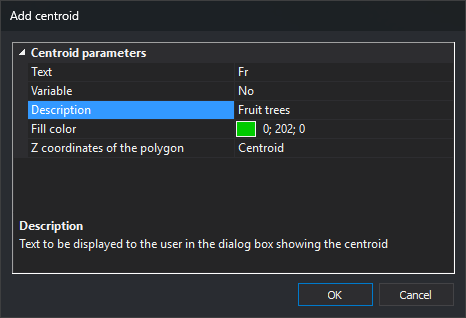

# Add centroid
<!-- id: anadir-centroide -->
<!-- origen: db0f2a82fb5cca7cd8a527f898ef0a67345a8713 -->

Adds a centroid to the topology.

## Text

Text stored in the drawing file when this centroid type is inserted.

## Variable

Whether the stored text is variable.

Variable centroid text can contain street names, for example.

## Description

Text identifying this centroid in the insertion dialog.

> For example, Description “Fruit tree” identifies centroid text “Fr” by vegetation type.

## Fill color

Color for filling [topological polygons](poligonos-topologicos.md) associated with this centroid.
