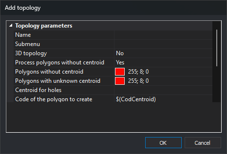

# Add topology
<!-- id: anadir-topologia -->
<!-- origen: 47fbc96baa14392340bba9d4a1a326dde373a6d6 -->

Configures a topology to add to the code table's topology list.

## Name

Topology name, used for options in the dynamic [Topology](/digi3d-ai/referencia/ventana-de-dibujo/menus/topologia.md) menus.

## Process polygons without centroid

Whether topology analysis reports an error for each [topological polygon](poligonos-topologicos.md) without a centroid.

## Polygons without centroid

Fill color for _topological polygons_ without a [centroid](centroide.md).

A strong color such as pure red makes these easy to identify.

## Polygons with unknown centroid

Fill color for polygons whose centroid is absent from this topology's configured centroid set.

## Centroid for holes

Text identifying centroids treated as [holes](centroide.md#holes).

## Code of the polygon to create

Code used when [generating polygons](/digi3d-ai/referencia/ventana-de-dibujo/menus/topologia.md) from this topology.

Accepts a [macro](/digi3d-ai/referencia/macros.md), such as `$(CodigoCentroide)` or `$(TextoCentroide)`.

## Polygon Z coordinates

Source of Z for each generated polygon vertex:

* **From the centroid**: all vertices take the centroid's Z.
* **2.5D from polygon geometries**: uses constituent geometry Z values. At a node where incoming lines have different Z values, uses one of them.
* **3D from polygon geometries**: uses constituent geometry Z values. At a node with different incoming Z values, includes both to form a three-dimensional polygon.
* **Project on a loaded DTM**: takes Z from digital terrain model (DTM) files loaded when converting topology to polygons.

## Tag of the DTM to project onto

If [Polygon Z coordinates](anadir-topologia.md#polygon-z-coordinates) is **Project on a loaded DTM**, optionally enter a tag here.

Only DTM files with that tag will be used.

> For example, several loaded GeoTIFFs may have tags MDT (terrain) or MDS (surface). Enter MDS to project topology polygons onto files tagged MDS.
