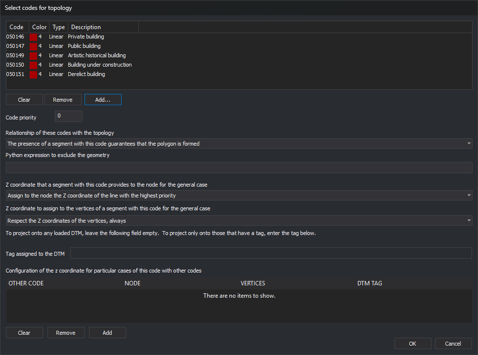

# Select codes for topology
<!-- id: seleccionar-codigos-para-topologia -->
<!-- origen: a4dbaf95212cd402c29f68d0e557c0fc119b00d2 -->

Adds codes of geometries \(lines and centroid text\) participating in a topology.

Opened by **Add** and **Modify** in the topology code list. Accepting adds all listed codes with the same settings \(relationship, exclusion expression, Z coordinates, etc.\). With **Modify**, the list contains the edited code and **Clear**, **Remove** and **Add...** are disabled.

## Codes to add

Codes added when the dialog is accepted.

* **Clear**: empties the list.
* **Remove**: deletes the selected code.
* **Add...**: opens [Select codes](../../../cuadros-de-dialogo/seleccione-codigos.md) and adds chosen codes.

## Code priority

Integer. A line with several topology codes uses settings from the highest-priority code. Node option **Assign to the node the Z coordinate of the line with the highest priority** compares this value between two sections.

## Relationship of these codes with the topology

Whether a line with one of these codes ensures polygon formation:

* **A section with this code must exist to form the polygon**: analysis includes a [topological polygon](poligonos-topologicos.md) only with at least one such section.
* **The presence of a section with this code guarantees that the polygon is formed**: analysis includes a polygon with at least one such section.
* **The presence of a section with this code does NOT guarantee that the polygon is formed**: a region formed only by lines with this code is ignored.
* **The presence of a section with this code does NOT guarantee that the polygon is formed, but it does guarantee holes**: as above, but regions formed with these lines count as holes.

## Python expression to exclude the geometry

Evaluated for each line with a listed code during polygon formation. True excludes it from topological polygons. An empty expression excludes nothing.

## Z coordinate that a section with this code provides to the node for the general case

Used when the topology's [Polygon Z coordinates](anadir-topologia.md#polygon-z-coordinates) comes from polygon geometries. Determines the Z of a node where this section meets another:

* **Assign to the node the Z coordinate of the line with the highest priority**
* **Assign to the node the Z coordinate of the section with this code**
* **Assign to the node the Z coordinate of the other section**
* **Assign to the node the maximum Z coordinate between the two sections**
* **Assign to the node the minimum Z coordinate between the two sections**
* **Assign to the node the centroid coordinate**
* **Interpolate**
* **Assign to the node the coordinates obtained by projecting its coordinates on the loaded DTMs.**

## Z coordinate to assign to the vertices of a section with this code for the general case

Each option combines an action and condition:

* Actions: **Respect the Z coordinates of the vertices**, **Interpolate between the two nodes of the section**, **Assign the centroid Z coordinate** and **Project on a loaded DTM**.
* Conditions: **always**, **if the section coincided in Z at both ends**, **if the section coincided in Z at least at one end** and **if the winning Z coordinate at both nodes was that of this section**.

## Tag assigned to the DTM

Enabled only if nodes or vertices are projected onto a DTM. Empty uses any loaded DTM; a tag restricts projection to DTMs with that tag.

## Configuration of the z coordinate for particular cases of this code with other codes

Exceptions to the general node rule when this code meets another. **Add** opens **Add particular case for Z treatment between sections**; **Remove** deletes the selected case; **Clear** deletes all.
