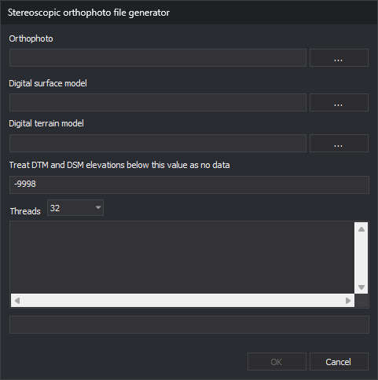

# Stereoscopic Orthophoto file generator
<!-- id: generador-de-archivos-de-ortofoto-estereoscopica -->
<!-- origen: 029f9dd815dd806494edad432f23cf278c8d145f -->

Creates HMP (*Height Map Pyramidal*) files for Digi3D.AI's [Stereoscopic orthophoto](ventana-fotogrametrica/sensores/ortofoto-estereoscopica.md) sensor.

## Notes

The sensor displays orthophotos stereoscopically by projecting them onto a digital surface or terrain model.

HMP files require at least one digital model: surface, terrain or both.

Creates the HMP beside the orthophoto with the same name and `.hmp`, replacing any existing file.

## Ortho

Enter the orthophoto path. **...** opens selection of Digi3D.AI-supported image formats.

Incompatible orthophotos are converted. Without pyramid levels or `.pyr`, asks whether to create them.

## Digital surface model

Enter one or more surface model files. **...** supports multiple selection, appending quoted paths to existing entries.

Supported formats:

| Extension | Format |
| :--- | :--- |
| `.tif` | GeoTIFF digital model. |
| `.asc` | ArcGIS ASCII digital model. |
| `.las`, `.laz` | LAS or LAZ point cloud. |
| `.e57` | E57 point cloud. |

Optional if a digital terrain model is supplied.

For each cell, searches heights first in point clouds, then GeoTIFF, then ArcGIS ASCII, using the first file with data at that point.

## Digital Terrain Model

Enter one or more terrain model files. Works like **Digital surface model** with the same formats.

Optional if a digital surface model is supplied.

## Value (DTM/DSM) below which it is considered no data

Heights at or below this value are no-data cells. Default -9998. HMP cells with no data in either model receive this value.

## Threads

Selects thread count, from 1 to the computer's logical processor count; defaults to the maximum.

Higher values speed up processing but slow other operating system tasks.

## Results

Below **Threads**, the text box shows the current pyramid level and TIFF (Tagged Image File Format) read errors and warnings. The progress bar tracks the current level.

## OK

Click to create the stereoscopic orthophoto file.

Enabled only when the orthophoto exists and at least one digital model field is filled.

If no model overlaps the orthophoto, reports this without starting. All fields and buttons are disabled during processing.

On completion, displays a message and clears **Ortho**, **Digital surface model** and **Digital Terrain Model**. Uncreated tiles are reported as an empty tile count. Failure displays its reason and retains fields for another attempt.

## Cancel

Click to exit. Unavailable during processing.
