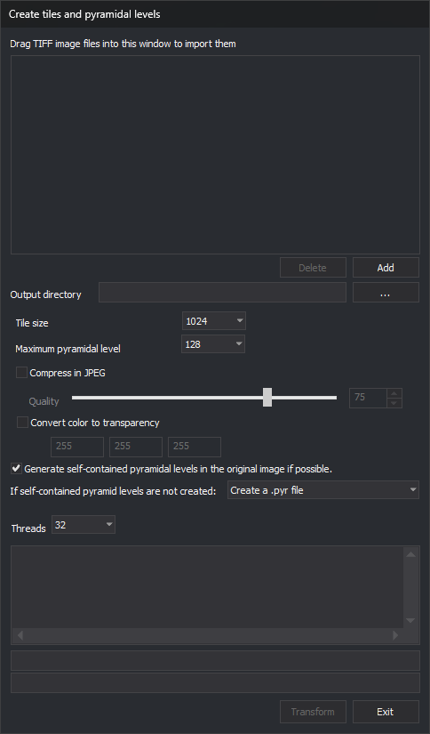

# Pyramid Level Generator
<!-- id: generador-de-niveles-piramidales -->
<!-- origen: 9727ac7f7cb838733eb06e7f9e90aea6b1c5d305 -->

Batch-converts TIFF (Tagged Image File Format) images for Digi3D.AI compatibility and creates pyramid levels. The window is titled **Create tiles and pyramidal levels**.

## Notes

Digi3D.AI requires tiled TIFF images, composed of small image tiles.

It also requires pyramid levels: copies of the image at different resolutions. Levels may be embedded in the TIFF or stored externally, usually in `.pyr`, a TIFF renamed to .pyr containing levels 2, 4, 8…

Loading an untiled TIFF opens [Image not prepared for Digi3D.AI found](cuadros-de-dialogo/localizada-una-imagen-no-preparada-para-digi3d-ai.md), offering conversion.

A tiled TIFF without pyramid levels is already compatible, so Digi3D.AI does not ask whether to convert it. It displays the “Compatible image without pyramid levels” dialog, which offers to generate the pyramid levels:

* If the image is a local TIFF file (`.tif` or `.tiff`) made up of a single file, with 8 or 16 bits per sample (no 12-bit JPEG), square tiles of even width and the samples of each pixel stored together, Digi3D.AI rewrites it as a COG (*Cloud Optimized GeoTIFF*) with the pyramid levels inside the same file, under the original name. It copies the tiles of the full level without recompressing them and generates the reduced levels with the compression of the full level (with quality 75 if it is JPEG). Digi3D.AI keeps the original file in the same folder with the first free suffix `__0`, `__1`… appended to its full name (for example, `foto.tif__0`).
* If the image does not meet those requirements, or is not a TIFF file, Digi3D.AI generates the pyramid levels in separate files (`.tif_2`, `.tif_4`…).

Digi3D.AI opens without modifying it a tiled TIFF image that already has internal pyramid levels, even if it is not a COG.

Use Pyramid Level Generator to batch:

* Convert incompatible untiled TIFFs to tiled, Digi3D.AI-compatible images and create pyramid levels.
* Create levels for already tiled images. With [Generate self-contained pyramidal levels in the original image if possible.](#generate-self-contained-pyramidal-levels-in-the-original-image-if-possible) enabled, the program rewrites those images as COG. With the option disabled, the program does not modify the image and creates external levels beside the original, even with an **Output directory** specified.

With self-contained levels disabled, for an already tiled image with levels, the program neither modifies the image nor generates its pyramid levels again, and reports this in Results. In that case, a tiled TIFF containing more than one image is considered to have pyramid levels.

## Drag TIFF image files to be imported to this window

In File Explorer, select files and drag them into the list.

Only .tif, .tiff and .smti are accepted. Existing list entries are not added again.

Files dragged during processing are ignored.

Dragging folders prompts to include their TIFFs and subfolders. **Yes** adds .tif, .tiff and .smti recursively; **No** adds none from the folders. Asked once per drop, even for multiple folders.

### Delete button

Removes the selected file. Only one can be selected, so removing several requires repeated clicks. Disabled with no selection.

### Add button

Opens multiple selection for .tif, .tiff or .smti. Rejects .pyr because these are generated pyramid files.

## Output directory

Optional. **...** opens folder selection.

* With a directory, creates resulting images there using original names. Creates a missing directory's last path component only: its parent must exist. Supports [substitutions](cuadros-de-dialogo/sustituidores.md); a changed path is shown in Results.
* Empty, renames each original by appending `__0` after the extension (or `__1`, `__2`… if necessary), such as `foto.tif__0`, then writes the new image under the original name.

With self-contained levels disabled, the output directory applies only to images being tiled. Their external levels are created beside the resulting image, from that image. Already tiled images get external levels beside the original.

With self-contained levels enabled, the output directory also applies to images that were already tiled and that the program rewrites as COG, and to the unchanged copy of an image that is already a COG. The program overwrites a file with the same name in the output directory.

## Tile size

Tile dimensions in pixels: 64, 128, 256, 512, 1024, 2048 or 4096. Default 1024.

## Maximum pyramidal level to be created

Select 1, 2, 4, 8… through 8192. Each level halves the previous image dimensions. Default 128. This becomes the maximum selectable level in the photogrammetric window's status bar.

## Compress in JPEG

Enable JPEG compression for generated images. Off by default. Applies to tiled images, .pyr level 2 and individual pyramid TIFFs. .pyr levels 4 and above remain uncompressed.\
With **Compress in JPEG** and self-contained pyramid levels enabled, the program compresses all the reduced image levels with JPEG and the selected quality if the image has 8 bits per sample; with 16 bits per sample, it saves the reduced levels uncompressed. For an image that was already tiled, the program copies the tiles of the full level without recompressing them.\
Usually unnecessary: Digi3D.AI generates and loads BigTIFF without a file size limit.

### Quality

Select 0–100 with the slider or text field. Default 75. Higher quality means less compression. Enabled only with **Compress in JPEG**.

## Transform color in transparency

Original images may lack transparency but use a special color for transparent areas.

Enabling adds an alpha channel, making the specified color transparent. Off by default.

Enables Red, Green and Blue fields for the transparent color; defaults to 255, 255, 255 (white).

Applies only to newly tiled images with 1 or 3 channels. One-channel images use Red only. Four-channel and already tiled images remain unchanged.

## Generate self-contained pyramidal levels in the original image if possible.

Enabled by default. Embeds levels in the resulting image, producing one TIFF with tiles and levels. That file is a COG (*Cloud Optimized GeoTIFF*): all the image directories are at the start of the file and the tiles go from the smallest level to the full level. This organization lets Digi3D.AI read the image from a URL downloading only the tiles it needs (see [Publishing a photogrammetric project in Azure Blob Storage and loading it from a URL](../procedimientos/publicar-proyecto-fotogrametrico-remoto.md)).

The result depends on the input image:

* **Image without tiles**: the program writes the tiled TIFF with its pyramid levels to a temporary file with the output name and the extension `.cog.tmp`, reorganizes it as COG in the output file and deletes the temporary file.
* **Tiled image**: the program copies the tiles of the full level without recompressing them, generates the reduced levels again with the selected compression (even if the image already had internal levels) and writes the COG.
* **Image that is already a COG**: the program does not modify it and writes to Results “The file *file* is already a COG (Cloud Optimized GeoTIFF). It was not modified.” If you specified an **Output directory** and the output file is a different file from the input, the program copies the image to the output file unchanged.
* **Tiled image with each color channel stored in a separate plane, with non-square tiles or with an odd number of pixels per tile row**: the program does not convert it to COG and writes the reason to Results, with a message that starts with “Warning:”. It keeps the internal pyramid levels the image has; if it has no internal levels, it creates external levels as the next section describes.

If the conversion to COG fails or you cancel it, the program restores the initial name of the original file, if it had renamed it. If the conversion fails, the program also writes to Results “Error: Unable to create the COG (Cloud Optimized GeoTIFF): *file*. The original image was not modified.”; if you cancel it, it does not write that message.

### If self-contained pyramid levels are not created:

Select the external level format. The selected format is used when self-contained levels are disabled or when the program cannot convert a tiled image to COG:

* **Create a .pyr file** (default): one file named after the image with .pyr, such as `foto.pyr`.
* **Create a TIFF file for each pyramid level**: one per level, with `.tif_` followed by the level, such as `foto.tif_2`, `foto.tif_4`…

## Threads

Select thread count, from 1 to the computer's logical processor count; defaults to the maximum. Each thread processes a listed file.

Higher values speed up processing but slow other operating system tasks.

## Transform

Starts processing; enabled when the list is nonempty. All controls except **Exit** are disabled. Results shows the file and current pyramid level; the first progress bar tracks the current operation, the second the processed file count. Each processed file leaves the list even on failure, whose reason stays in Results. Completion displays “Work concluded satisfactorily” or the error count.

## Exit

Closes the application. Stops active processing first: deletes the file under construction (retaining completed pyramid files) and restores the original name if the image had been renamed.
