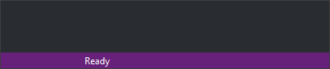

# Ready mode
<!-- id: modo-preparado -->
<!-- origen: cbd970194167bfc8599a4db597763967ab2bd1e7 -->

Digi3D.AI is in ready mode when no command is running.

The status bar displays **Ready** in this mode.

