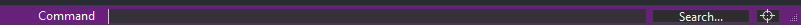
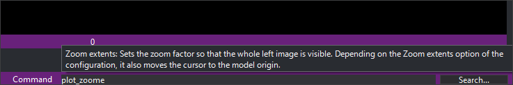

# Running a command from the command line
<!-- id: ejecutar-una-orden-desde-la-linea-de-comandos -->
<!-- origen: e560f38a1bde80d5f22d41bc907ebf6f53be7ee5 -->

In the drawing window, press **Enter** to display a command name field in the message bar.

Enter the command name and press **Enter** to run it.

Three command types can be run:

* [Built-in commands](orden-interna-de-digi3d.ai.md)
* [Macroinstructions](/digi3d-ai/referencia/ventana-de-dibujo/ordenes/m/macroinstrucciones.md)
* [Python scripts](/digi3d-ai/referencia/ordenes/formas-de-ejecutar-una-orden/ejecutar-una-orden-desde-la-linea-de-comandos/guiones-python.md)

## Autocompletion and parameter help

As you type a command name, the field proposes the first name starting with your input, selecting the added portion. Further typing replaces that selection. Press **Tab** to accept: the cursor moves to the end and the proposal is no longer selected.

To pass parameters, type an equals sign (=) after the command name, then space-separated parameters, for example `densifica=5 020100`. Enclose parameters containing spaces in double or single quotes.

If the command describes its parameters, help above the field shows usage forms:

* Each line is one way to run the command. Only forms compatible with current input appear.
* Each parameter appears as `<nombre: tipo>`. Types can be integer, real number, text, file, code, or a list of accepted values separated by `|`.
* The parameter currently expected appears in **bold**.
* `...` after a parameter means one or more values. A parenthesized group followed by `...`, such as `(<código: código> <tipos de entidad: texto>)...`, repeats as a whole one or more times.
* Some parameters depend on an earlier value. For example, [BINTRAM](/digi3d-ai/referencia/ventana-de-dibujo/ordenes/b/bintram.md) has seven error file parameters only when its second parameter is `1`. They appear when you enter that value.
* **(opens a dialog box)** at the end indicates that this form requests missing data in a dialog.
* If the current parameter accepts a value list, descriptions of values starting with the entered text appear below usage forms, for example `2 = split the lines at the crossing`.

For parameters restricted to a value list, the field proposes the first value starting with your input, like command name completion. **Tab** accepts it.

Help disappears when the field loses focus. Parameter names and value descriptions use the Digi3D.AI interface language.

## Command history

The field opens with the last executed command selected. Press **Enter** again to repeat it. Typing replaces the selection. If no command has run, the field starts empty.

Arrow keys visit previous commands:

* **Up arrow** shows the command before the displayed one, then successively earlier commands. At the oldest, it stays there.
* **Down arrow** shows the next, newer command. Moving beyond the newest clears the field.

Arrows visit the entire history even when the field contains text; they do not filter by that text.

Digi3D.AI saves history to `%APPDATA%\Digi3D\HistoricoOrdenes.txt` each time a command runs, preserving it between sessions. The file holds the 1000 most recent commands, one per line. A command identical to the preceding one is not saved again.

Each drawing window reads the file when opened. Commands run in another drawing window or Digi3D.AI instance appear in windows opened afterward.

## In the photogrammetric window

Pressing **Enter** in the photogrammetric window displays the same message bar field. **Enter** always opens it, even if assigned commands in the active virtual keyboard.

It works as in the drawing window, with these differences:

* Only [photogrammetric window commands](/digi3d-ai/referencia/ventana-fotogrametrica/ordenes/README.md) run, and only their names are proposed.
* These commands do not describe their parameters. The command title and description appear above the field instead of usage forms.
* Everything after the first equals sign is passed as parameters, for example `speed=5.75 4.22`.
* **Esc** closes the field without running anything.
* History is separate, saved to `%APPDATA%\Digi3D\HistoricoOrdenesFotogrametria.txt` with the same rules.

If the drawing window field is open, pressing **Enter** in the photogrammetric window focuses it. Opening the drawing window field closes the photogrammetric field.

The field also accepts an internal command name in braces, for example `{3BE1084C-E1BC-4b4f-AD45-611112560D6B}=5.75` for [SPEED](/digi3d-ai/referencia/ventana-fotogrametrica/ordenes/v/velocidad.md), and command names in the other Digi3D.AI language. An unrecognized photogrammetric command name plays the error sound and runs nothing.
