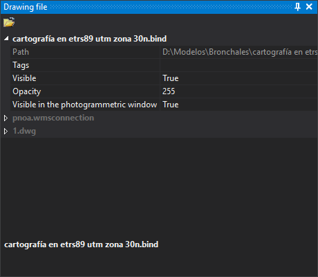

# Drawing file
<!-- id: panel-archivos-de-dibujo -->
<!-- origen: 95745eed9f47fbf7bc62237eae1a3b398a76d80e -->

This pane shows drawing files loaded in the drawing window: the working file and reference files. Each file is a named group. The active file's name uses the theme's text color (white in the dark theme); other names are gray.

## Toolbar

* **Load reference file**: loads a drawing file as a reference. Its entities cannot be edited.

## Fields for each file

* **Path**: full file path. Read-only.
* **Tags**: comma-separated tags identifying the file in commands that support them.
* **Visible**: whether file entities are drawn in the drawing window.
* **Opacity**: file opacity in the drawing window, from 0 (invisible) to 255 (opaque).
* **Visible in the photogrammetric window**: whether file entities are drawn in the photogrammetric window.

Some formats add their own fields to the file group.

## Context menu

Right-click a filename for these options:

* **Zoom to extension of file**.
* **Zoom to the file's first entity** and **Zoom to the file's last entity**: deleted entities are ignored.
* **Set as an active file**: makes this the working file. Disabled for the active file.
* **Download this file**: unloads the file from the drawing window. Disabled for the active file and when only one file is loaded. Unloading a file also unloads loaded topologies and the temporary topology.

  If the format stores entity deletion marks in the file itself (for example, database formats), the file is writable and contains entities marked as deleted, Digi3D.AI asks: “There are entities marked as deleted that have not been removed yet: […] Do you want to compress now?”.
  * **Yes**: compresses and unloads the file. If compression fails, displays an error and does not unload it.
  * **No**: unloads without compressing.
  * **Cancel**: does not unload the file.
* **Show horizontal reference coordinate system...** and **Show vertical reference coordinate system...**: show the file reference system in [Coordinate reference system parameters](../cuadros-de-dialogo/parametros-del-sistema-de-referencia-de-coordenadas.md).

## Showing the pane

Select **Window/Drawing file**.
