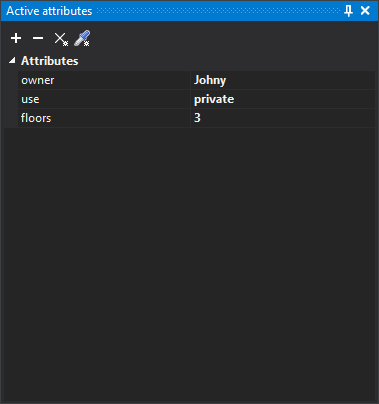
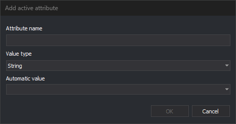

# Active attributes
<!-- id: atributos-activos -->
<!-- origen: ae27e2155028dfc5352121f66fa7e3969fd9272c -->

Use the Active attributes pane to add attributes to assign to new entities.

Attributes are key-value pairs that store information of any type.

Digi3D.AI copies active attributes to new entities stored with the active codes. Existing entities do not change. To apply active attributes to existing entities, use [CHNG\_ATTRIBUTES](../ventana-de-dibujo/ordenes/c/camb_atributos.md) and [UPDATE\_ATTRIBUTES](../ventana-de-dibujo/ordenes/a/actualiza_atributos.md). [ADD\_ACTIVE\_ATTRIBUTE](../ventana-de-dibujo/ordenes/a/anade_atributo_activo.md) adds an attribute to this list.

Numbers with decimal places are displayed and entered with a period (`12.5`), regardless of Windows regional settings. A numeric value with a comma causes a conversion error.

If you clear an attribute's value in the pane, the attribute has no value (NULL).

## Toolbar

The pane has a toolbar for working with its contents.

### Buttons

* **Add attribute**: open the **Add active attribute** dialog box.
* **Remove selected attribute**: remove the selected active attribute.
* **Clear**: remove all active attributes.
* **Clone attributes**: run [CLONE\_ATTRIBUTES](../ventana-de-dibujo/ordenes/c/clonar_atributos.md), which replaces the active attributes with those of the entity you select.

The buttons are disabled when no drawing window is open.

## Add active attribute dialog box

Add an attribute to the active attribute list.

* **Attribute name**: name of the attribute. If an active attribute with that name already exists, the dialog box closes without adding the attribute or displaying a warning.
* **Value type**: attribute data type: string, signed or unsigned 8-, 16-, 32-, or 64-bit integer, single- or double-precision floating point, or date. **Cadena de caracteres** is selected when the dialog box opens. The attribute is added with an empty or zero value, which you then change in the pane.
* **Automatic value**: optional. A fixed list of [database macros](../editor-de-tablas-de-codigos/pestanas/base-de-datos/macros-de-base-de-datos.md), such as `%UID%` or `%ENTITY_AREA%`; you cannot enter another value. Digi3D.AI calculates the value when storing each entity and converts it to the selected **Value type**. If the value cannot be converted to that type, Digi3D.AI displays an error each time it stores an entity, and the entity receives the macro text. An attribute with an automatic value cannot be edited in the pane.
* **OK**: add the attribute. Disabled while the name is empty.
* **Cancel**: close the dialog box without adding the attribute.

## Show the pane

Select **Window/Active attributes** from the menu.
