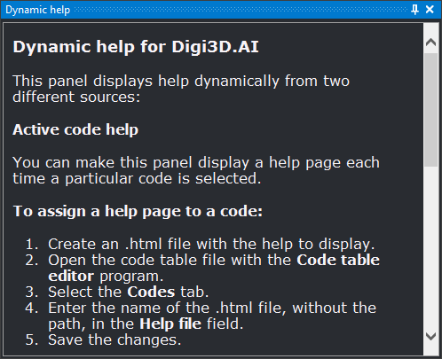

# Dynamic help
<!-- id: ayuda-dinamica -->
<!-- origen: 1060875d8d2297ff66a9abcc03b32201f2f21211 -->

This pane shows HTML help pages. Initially it shows a page explaining its configuration. It then shows:

* **Help for the selected code.** Whenever a code with an assigned help file is selected, the pane shows that file. To configure it:
  1. Enter the .html filename in the code's [Help file](../editor-de-tablas-de-codigos/pestanas/codigos/propiedades-del-codigo.md) field in the **Code table editor**.
  2. Enable [Show help by code](../cuadros-de-dialogo/configuracion/comunicacion-con-el-usuario/mostrar-ayudas-por-codigo.md) in **Configuration**.
  3. Set [Code help directory](../cuadros-de-dialogo/configuracion/comunicacion-con-el-usuario/directorio-de-ayudas-de-codigos.md) to the folder containing the .html files.
* **Help for a database field.** Selecting a field in [Database fields](campos-de-la-base-de-datos.md) shows it in **Dynamic help** with the same title as in **Database fields** (name, title or both, according to [Name to show](../cuadros-de-dialogo/configuracion/base-de-datos/nombre-a-mostrar.md)), its description and, if it has a value list, a table with each value, title and description.
* **Any HTML document** specified with [SHOW_HELP](../ventana-de-dibujo/ordenes/m/muestra-ayuda.md), for example from a macro. The command shows the pane and loads the document only if the file exists or the location is a web address.

## Showing the pane

Show it in either way:

* Click its button on the [Panes toolbar](../barras-de-herramientas/paneles.md).
* Select **Help/Dynamic help**.
