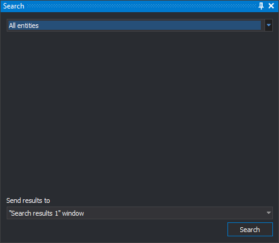
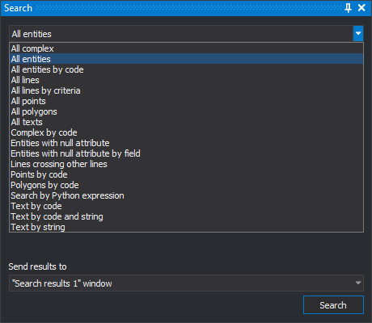

# Search
<!-- id: buscar-2 -->
<!-- origen: 6c9d9c5f5934ec5e33c03653a314da6d38ccd8a0 -->

This pane searches drawing file entities by a criterion.

Digi3D.AI's search types are in the open source [DigiNG.Search](https://github.com/digi21/DigiNG.Search) repository. Consult it to see how each search works and use it as an example for programming your own.

## Fields

* **Search type** (upper drop-down): search criterion. The pane's central area shows options for the selected type.
* **Send results to**: destination for found entities. Initially **Search results 1** is selected.
  * **Search results 1** or **Search results 2**: shows that pane, clears its previous results and adds found entities.
  * **Active command**: the running command. If it supports multiple selection, it receives found entities and performs its task on them.
* **Search**: searches the active drawing file in the drawing window. Enabled when a search type is selected; does nothing if no drawing window is open.

## Search types

* Search by Python expression
* Complex by code
* Entities with null attribute
* Entities with null attribute by field
* Lines crossing other lines
* Poligons by code
* Points by code
* Text by string
* Text by code
* Text by code and string
* All entities
* All entities by code
* All lines
* All lines by criteria
* All complex
* All polygons
* All points
* All texts

## Showing the pane

Select **Edit/Search**.

## Example

To export every text in the drawing file to a new file:

1. Select **File/Export selected entities...**.
2. Open the pane with **Edit/Search**.
3. Select **All texts**.
4. Under **Send results to**, select **Active command**.
5. Click **Search**.
6. Enter the destination filename and click **Save**.
