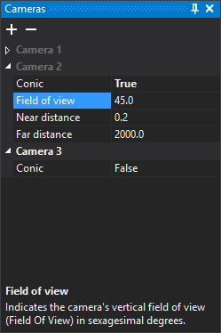

# Cameras
<!-- id: panel-camaras -->
<!-- origen: 50fdddead22aafb3517e9622e75209384cd6638e -->

This pane defines cameras used to display the drawing in perspective in the drawing window. Each camera is a named group. The active camera's name uses the theme's text color (white in the dark theme); the others are gray. Click a name to activate another camera. Clicking only activates it if a drawing window is open.

At startup the pane has one camera, **Camera 1**, with orthogonal projection.

## Toolbar

* **Add camera** (**+**): adds a camera with the active camera's parameters and activates it.
* **Delete camera** (**−**): deletes the selected camera after confirmation. If none is selected, deletes the active camera. The last camera cannot be deleted.

## Fields for each camera

* **Conic**: whether projection is conical (**True**) or orthogonal (**False**). The next three fields appear only for conical cameras.
* **Field of view**: vertical field of view in sexagesimal degrees. Default: 45.
* **Near distance**: camera-to-near-plane distance. Anything closer is not rendered. Default: 0.2.
* **Far distance**: camera-to-far-plane distance. Anything farther away is not rendered. Default: 2000.

## Showing the pane

Select **Window/Cameras**.
