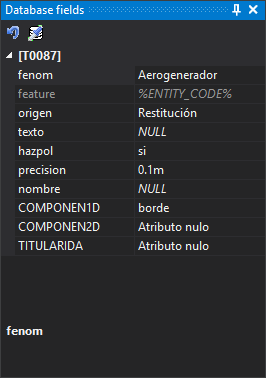

# Database fields
<!-- id: campos-de-la-base-de-datos -->
<!-- origen: 320c69b6e8a11640c4db1642962b5dc0e10e2b95 -->

This pane shows fields from the database table associated with the active code and values that will be stored for geometries digitized with that code. It is used when the drawing file works with a database.

Changing the active code shows that code's table fields. The category title is the table name in brackets, for example “[T0087]”.

## Fields

Each row is a table field:

* Field names follow [Name to show](../cuadros-de-dialogo/configuracion/base-de-datos/nombre-a-mostrar.md).
* Primary key fields, logical fields and fields marked invisible in the code table are omitted.
* Fields assigned to a group in the code table appear in a subcategory named after that group.
* Fields with possible value lists show a drop-down. The list may come from the code table or a `%SELECT …%` database query. If the query fails, the field shows its stored value without a drop-down.
* With **Show search box** enabled in the code table, an ellipsis button beside the drop-down opens a value search dialog.
* Fields that cannot be edited are dimmed, such as those required to retain their default value.
* A field without a value shows its code table default if the code has no database record yet and the field has a default. Otherwise it shows *NULL*.
* Changed values are highlighted.

If reading fields fails, the pane adds “Error when showing the database fields” to [Tasks](tareas.md), shows Tasks and opens a dialog with “Detected an error when showing the database fields.”. **More information** identifies the code, table, record identifier, code table, data model and connection string.

Selecting a field shows its description below and displays its description and possible value table, if any, in [Dynamic help](ayuda-dinamica.md).

Configure each field's name, description, default and value list in the code table's [field properties](../editor-de-tablas-de-codigos/pestanas/base-de-datos/propiedades-de-los-campos.md).

## Toolbar

* **Assign the default values of the code table**: replaces pane values with the active code's defaults from the code table.
* **Clone the database fields of an entity**: runs [CLONE_BBDD_FIELDS](../ventana-de-dibujo/ordenes/c/clonar-campos-bbdd.md), copying selected entity field values into the pane.

Both buttons are enabled only when the pane shows at least one field.

## Showing the pane

Show it in either way:

* Select **Window/Database fields**.
* Press Alt+Shift+B.
