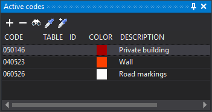

# Active codes
<!-- id: codigos-activos -->
<!-- origen: ec5fec72bbf2205d7aa65e9a5be34db62f9e9391 -->

Active codes selects the active code or codes when working with multiple codes per geometry.

A new geometry receives every listed code when stored, not just the selected code. Only one row can be selected at a time.

The **Multi-coding panel** option under [Interface for selecting codes](../cuadros-de-dialogo/configuracion/diging/interfaz-para-seleccionar-codigo.md) controls the menu option that shows the pane and **Add code**, **Remove code**, **Select code**, **Copy entity code** and **Add entity code** as described below: without this option, the menu and all these buttons except **Remove code** are disabled. The list and **Remove code** always work.

When adding codes:

* Existing codes are not added again unless configuration allows duplicate codes on geometries.
* Codes disabled in the code table are not added.
* Table, **ID** and database attributes of all active codes are cleared.

## Toolbar

The toolbar controls pane contents.

### Buttons

* **Add code**: runs [COD+](/digi3d-ai/referencia/ventana-de-dibujo/ordenes/c/cod-mas.md), adding codes to the active list.
* **Remove code**: removes the selected active code. Disabled when none is selected. The last code cannot be removed.
* **Select code**: runs [COD](/digi3d-ai/referencia/ventana-de-dibujo/ordenes/c/cod.md), replacing active codes with your selection.
* **Copy entity code**: runs [CLONAR_CODIGOS](../ventana-de-dibujo/ordenes/c/clonar-codigos.md), replacing active codes with those of the selected entity.
* **Add entity code**: runs [CLONAR_CODIGOS+](../ventana-de-dibujo/ordenes/c/clonar-codigos-mas.md), adding the selected entity's codes to the active list.

## Columns

* **Code**: code name.
* **Table** and **ID**: associated database table and record number, when working with a database.
* **Color**: code color in the code table.
* **Description**: code description in the code table.

## Database

When working with a database, selecting a code makes [Database fields](/digi3d-ai/referencia/paneles/campos-de-la-base-de-datos.md) show the selected code's table from the code table.

## Showing the pane

Show it in either way:

* Select **Window/Active codes**.
* Press Alt+Shift+C.

Both methods are enabled only when **Multi-coding panel** is selected under Interface for selecting codes.
