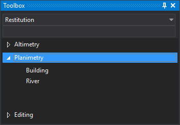

# Toolbox
<!-- id: cuadro-de-herramientas -->
<!-- origen: 1933e8a220f8c3217802f7147ed13d7076d0de01 -->

This pane shows the toolbox configured in the active code table.

## Pane areas

The pane has three parts:

* A folder selection drop-down.
* A search box filtering the main contents.
* Main contents showing categories and their options.

The drop-down and search box are disabled until a code table is loaded.

Selecting a folder shows all its categories, each containing options.

## Search

Typing in the search box shows only options whose titles or tags contain the text, ignoring case. Categories with no matching options are hidden.

## Running an option

Clicking an option runs its configured commands:

* One command: runs that command.
* Several commands: runs them in sequence as a macro.

If no drawing window is open, clicking an option displays “Error: No active view found” and runs no commands.

## Showing the pane

Show it in either way:

* Click its button on the [Panes toolbar](../barras-de-herramientas/paneles.md).
* Select **Window/Toolbox**.

## Toolbox configuration

Contents are configured in the [Toolbox tab](/digi3d-ai/referencia/editor-de-tablas-de-codigos/pestanas/cuadro-de-herramientas.md) of the [Code table editor](../editor-de-tablas-de-codigos/).
