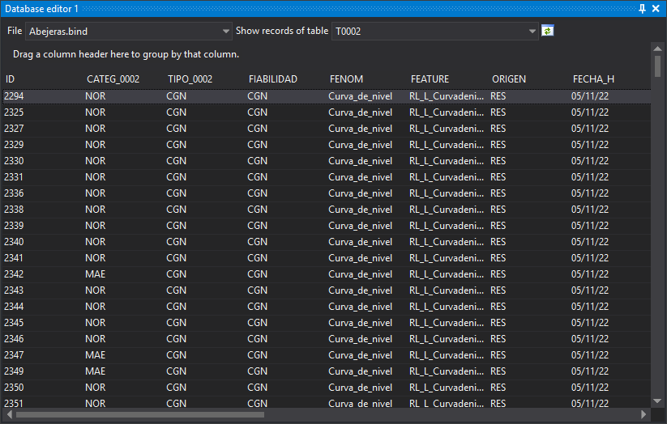

# Database editor 1,2,3,4
<!-- id: editor-de-la-base-de-datos-1-2-3-4 -->
<!-- origen: 0e0fa5d998ca60de5452391e1cadc60d1778c607 -->

Queries and edits the database connected to a drawing file.

Four identical panes (**Database editor 1** through **4**) let you view several tables at once.

## Toolbar

* **File**: drawing file whose database is shown. The drop-down contains the main drawing file and loaded reference files.
* **Show table registers**: database table whose records are shown.
* **Python expression**: appears only if **Display geometries complying with Python expression** is selected under [Tables/Records to show](../cuadros-de-dialogo/configuracion/editor-de-la-base-de-datos/tablas-registros-a-mostrar.md). Shows records of geometries matching the expression.
* **Regenerate**: rereads the selected table's records. Enabled when a table is selected.

## Records

Each row is a record and each column a field. Drag a column header to the upper area to group records by that field.

* Double-clicking a record makes the drawing window perform [Action on double-click](../cuadros-de-dialogo/configuracion/editor-de-la-base-de-datos/accion-al-hacer-doble-clic.md) and temporarily select its linked geometry for 2 seconds.
* Right-clicking records shows **Send selection to the active command**. Enabled only if the active command supports geometry selection. Sends geometries linked to the first selected record to the command.
* Values are editable only with [Allow editing the database](../cuadros-de-dialogo/configuracion/editor-de-la-base-de-datos/permitir-editar-la-base-de-datos.md) enabled. A read-only database remains uneditable even with that option enabled.
* Each changed value is written to the database when the cell is validated.

Displayed tables and records depend on [Tables/Records to show](../cuadros-de-dialogo/configuracion/editor-de-la-base-de-datos/tablas-registros-a-mostrar.md).

## Showing the pane

Show it in any of these ways:

* Click its button on the [Panes toolbar](../barras-de-herramientas/paneles.md).
* Select **Database/Database editor 1** through **Database/Database editor 4**.
* Press Alt+Shift+E for **Database editor 1**.
