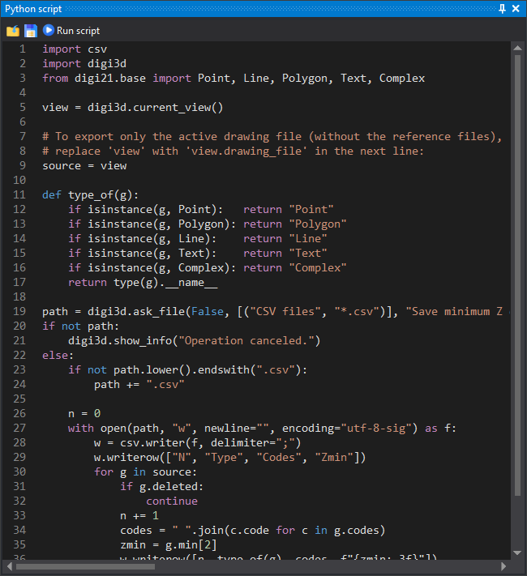

# Python script
<!-- id: guion-python -->
<!-- origen: 586acbf3c7515c4ea75879ecac15357423035c02 -->

This pane is a Python script editor with syntax highlighting. Scripts run in Digi3D.AI's Python interpreter, with access to the active drawing window through `digi3d`. See [Python pane](../../programacion/python/panel-de-python/README.md).

## Toolbar

* **Load script**: opens a `.py` and shows its contents in the editor.
* **Save script**: saves editor contents to a `.py`.
* **Play script**: runs editor contents.

## Running the script

* If a drawing window is active, all script changes to its drawing file form a single transaction: one [UNDO](../ventana-de-dibujo/ordenes/u/undo.md) reverses them all.
* If the script raises an exception, its message appears in a message box.

## Showing the pane

Select **Window/Python script**.

The pane exists only if registry value `CrearPanelPython` is nonzero. Default: 1.

## See also

* [Running scripts](../../programacion/python/panel-de-python/ejecutar-guiones.md): from the pane, as a command or as a quality control.
* [Programming examples](../../programacion/python/panel-de-python/ejemplos/README.md).
* [PYTHON](../ventana-de-dibujo/ordenes/p/python.md): command that runs a script file.
