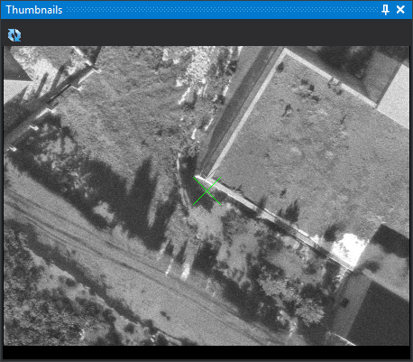

# Thumbnails
<!-- id: panel-instantaneas -->
<!-- origen: 034444c0cb0f24bbf4168912480bc1513eb50245 -->

This pane shows a thumbnail of the point being measured: the image saved when that point was measured in an earlier orientation. A 31-pixel X at the pane's center marks its position so you can find it in the model. The X uses the photogrammetric window cursor color.

Thumbnail zoom matches photogrammetric window zoom and changes with it.

The pane appears automatically in the photogrammetric window when running [AEROTRI](../ventana-fotogrametrica/ordenes/a/aerotri.md) (**Aerial triangulation measurement** in **Photogrammetric window**) and closes when it ends. It cannot be opened elsewhere.

## Toolbar

* **Rotate thumbnail**: rotates the thumbnail 180°. Useful if the point was measured in a strip flown in the opposite direction. The button stays pressed while rotated.

## Generating thumbnails

The pane only displays an image if thumbnails were saved when measuring:

* Enable [Save thumbnail](../cuadros-de-dialogo/configuracion/orientacion-absoluta/almacenar-instantanea.md).
* Configure the folder and size under [Thumbnails](../cuadros-de-dialogo/configuracion/instantaneas/README.md).

The pane reads `<punto>.bmp`, where `<punto>` is the point name, from the configured thumbnail directory. That directory is relative to the work directory.
