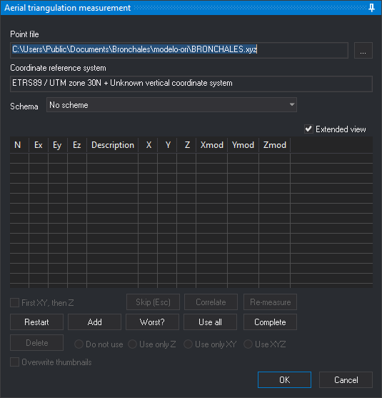

# Aerotriangulation measurement
<!-- origen: 3db17ba7a9fef762d1c2a94f2dc05bedf8df4629 -->

This pane lets you measure the aerotriangulation points and control points of the model loaded in the photogrammetric window. The pane appears when you run the [AEROTRI](../ventana-fotogrametrica/ordenes/a/aerotri.md) command, which you can also run with the _T_ button of the photogrammetric window toolbar.

The pane has the same controls as the pane of the [ABSOLUTE\_ORI](../ventana-fotogrametrica/ordenes/o/ori-absoluta.md) command, with the **Schema** drop-down list, which selects the aerotriangulation pattern used to go through the points, and with the differences in the **Add** and **Accept** buttons that the [Aerial triangulation measurement pane](../ventana-fotogrametrica/ordenes/a/aerotri.md#aerial-triangulation-measurement-pane) section of the AEROTRI command describes.

When you click **Accept**, Digi3D.AI writes to the project's **Aerotriangulación** folder a _.mod_ file with the model coordinates of the measured points and one photocoordinates file per photo. For a usage example, see [Measuring aerotriangulation for model 107-108](../../primeros-pasos/comenzando-a-utilizar-digi3d.ai/comenzando-con-la-ventana-fotogrametrica/sensor-camara-conica/aerotriangulacion-manual/midiendo-aetrotriangulacion-modelo-107-108.md).
