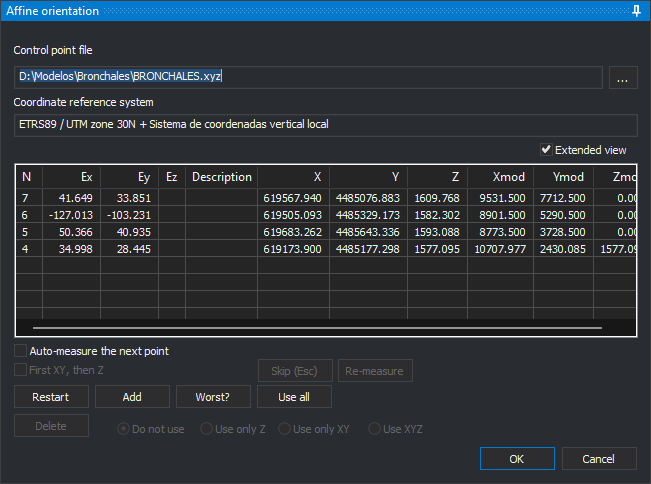

# Orientation
<!-- id: panel-orientacion -->
<!-- origen: 2d3eb2cc32e0f4ddcbb8a31be62f4399ae0e4170 -->

This pane measures orientation control points and shows residuals for sensors without a dedicated pane. Opened by:

* **Affine orientation** for [Orthophoto](../ventana-fotogrametrica/sensores/ortofoto.md).
* **Exterior orientation** for the monoscopic conical sensor.
* Orientation options for [ADS](../ventana-fotogrametrica/sensores/ads.md) and monoscopic [RPC Satellite](../ventana-fotogrametrica/sensores/rpc/README.md).

Its title is the orientation being measured: “Affine orientation”, “Exterior orientation” or “Orientation”. If unsupported by the active sensor, Digi3D.AI displays “The active sensor does not permit this command to be run.” and does not open it.

Before opening, Digi3D.AI loads the last used control point file. If unreadable, it displays “Unable to load control point file.” and opens [Control point file](../cuadros-de-dialogo/archivo-de-puntos-de-apoyo.md). Cancelling prevents the pane from opening.

For affine orientation, and for other orientations not yet defined in the model, the pane immediately requests the first point with [Enter a terrain point of the point file](../cuadros-de-dialogo/introduce-punto-terreno.md). After selecting it, measure it in the photogrammetric window. The message line above **OK** identifies the point to digitize.

Unavailable buttons are disabled.

* **Control point file**: file with point ground coordinates. **...** opens [Control point file](../cuadros-de-dialogo/archivo-de-puntos-de-apoyo.md), where you can select another control point file.
* **Coordinate reference system**: system of the point file coordinates.
* **Extended view**: adds ground (**X**, **Y**, **Z**) and model (**Xmod**, **Ymod**, **Zmod**) coordinates to the list. Its state is remembered. The list becomes wider than the pane and gains a horizontal scrollbar; widen the pane to see all columns.
* **Measured point list**: each point's name (**N**), X, Y and Z residuals (**Ex**, **Ey**, **Ez**) and **Description**. Residuals appear with at least three measured points. Clicking a point moves the cursor there.
* **Auto-measure the next point**: once enough points exist to calculate orientation, measuring a point moves the cursor to the next point in the file that falls within the image.
* **First XY, then Z**: measures in two steps: the first input records plan position, the second Z.
* **Skip (Esc)**: while waiting for a point measurement, discards it and requests the next. With a listed point selected, clears selection.
* **Re-measure**: moves the cursor to the selected point for remeasurement. With none selected, displays “No point has been selected to be re-measured from the points list.”
* **Restart**: remeasures all points one at a time.
* **Add**: measures a new point, selected in [Enter a terrain point of the point file](../cuadros-de-dialogo/introduce-punto-terreno.md).
* **Worse?**: selects the point with the largest residual. Requires at least three measured points.
* **Use all**: uses X, Y and Z of every measured point again.
* **Delete**: deletes the selected point and recalculates orientation.
* **Do not use**, **Use only Z**, **Use only XY** and **Use on XYZ**: determine which selected point coordinates participate.
* **OK**: saves orientation and closes. Available with at least three measured points participating in the calculation. **Ctrl+Enter** does the same.
* **Cancel**: closes and restores the model's previous orientation.

## Affine orientation

Orthophoto affine orientation calculates a planar affine transformation between ground and image coordinates:

* Requires three points. **Ez** remains empty because the transformation does not calculate Z.
* Previous affine orientation points are not retained: reopening starts with an empty list.
* Accepting saves the transformation as a world file in the project folder, named after the image with the first and third extension letters followed by **w** (_.tfw_ for _.tif_), and its reference system in a matching _.prj_. If the world file cannot be created, displays “Error when creating file: *path*” and keeps the pane open.
* **Affine orientation** is checked in the menu when the model has an affine orientation.
