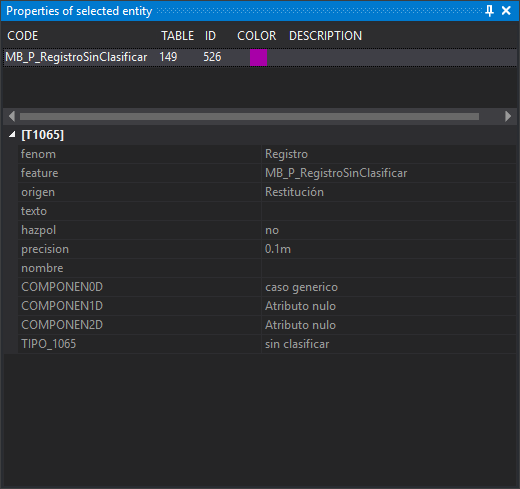

# Properties of selected entity
<!-- id: propiedades-de-la-entidad-seleccionada -->
<!-- origen: 0b734a40a308c33f6599d83729c706095e7592de -->

This pane shows codes and attributes of the last tentatively selected geometry. It is read-only: use [Database editor 1,2,3,4](editor-de-la-base-de-datos-1-2-3-4.md) to edit database attributes.

It updates whenever the mouse tentative button finds a geometry, including the intersection of two lines. Selecting or deselecting geometries does not change the pane. Contents remain until another tentative selection or until the drawing window closes.

## Showing the pane

Select **Window/Properties of selected entity**.

## Code list

The upper area shows the tentatively selected geometry's codes, one per row, in reverse order: the geometry's last code appears first.

* **Code**: code name.
* **Table**: database table linked to the code.
* **ID**: identifier of the database record linked to the code.
* **Color**: code color in the code table.
* **Description**: code description in the code table.

## Attributes

The lower area shows:

* **Attributes**: geometry attributes, if any.
* A code's database fields, in a category named after the table in brackets. Tentative selection shows fields for the geometry's first code, the last list row. Clicking another code shows its record's fields. This category is absent if the code has no database link, has no assigned ID yet or the drawing file has no database.

Fields marked invisible in the code table are hidden unless [Show fields not visible in the Properties pane of the selected entity](../cuadros-de-dialogo/configuracion/base-de-datos/mostrar-campos-no-visibles.md) is enabled.
