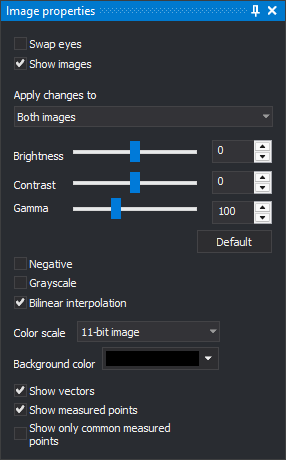

# Display properties
<!-- id: propiedades-de-visualizacion -->
<!-- origen: 6c02c80d28181fd9f8a504a5094593bd04ecb872 -->

This pane changes how images and vectors are drawn in the active photogrammetric window.

## Fields

* **Swap eyes**: shows the left image to the right eye and the right image to the left eye.
* **Show images**: when disabled, only vectors are drawn and radiometric controls are disabled.
* **Images to which changes are to be applied**: images affected by brightness, contrast, gamma, negative, grayscale, bilinear interpolation and color scaling: **Both images**, **Left image** or **Right image**.
* **Brightness**: −100 to 100. Default: 0.
* **Contrast**: −100 to 100. Default: 0.
* **Gamma**: 0 to 300, in hundredths (100 means gamma 1.0). Default: 100.
* **Default**: resets brightness to 0, contrast to 0 and gamma to 100, and enables bilinear interpolation.
* **Negative**: inverts image colors.
* **Grayscale**: draws grayscale images.
* **Bilinear interpolation**: smooths pixels when zooming in. When disabled, each pixel is drawn as a uniformly colored square.
* **Color scale**: significant bit count for images with 16 bits per band. Multiplies pixel values to fill the 16-bit range. For example, **11-bit image** multiplies each value by 32. **Do not scale color** leaves values unchanged.
* **Background color**: color of photogrammetric window areas not covered by images.
* **Show vectors**: draws drawing file entities over images.
* **Show measured points**: draws points measured in orientations.
* **Show only common measured points**: draws only points measured in both model images. Enabled with **Show measured points**.

Digi3D.AI saves brightness, contrast, gamma, negative, color scale and bilinear interpolation in the user registry and applies them to the next photogrammetric window opened.

## DEM

This section draws digital elevation model (DEM) points over images. It appears only if the user registry contains an alias for one of these DEM commands: save DEM, project DEM, project line onto DEM or move Z onto DEM. Controls are disabled unless the drawing window has a TIFF DEM loaded.

* **Show DEM points**: draws DEM points in the photogrammetric window.
* **Distance between points**: spacing of drawn points. The drop-down offers 1 to 40 times the DEM cell size. Loading a DEM selects 40 times the cell size.
* **Scale distance based on zoom**: multiplies point spacing by the reduction factor of the rendered image. Zooming out draws points farther apart.
* **DEM color**: point color.
* **Points size**: point size, from 1 to 10.
* **Show triangles**: draws the DEM with triangles.

Digi3D.AI saves color, point size, **Scale distance based on zoom** and **Show triangles** in the user registry.

## Showing the pane

Select **Photogrammetric window/Display properties...**.

## Example

See [Changing image radiometry in the photogrammetric window](../../primeros-pasos/comenzando-a-utilizar-digi3d.ai/comenzando-con-la-ventana-fotogrametrica/cambiando-radiometria-ventana-foto.md).
