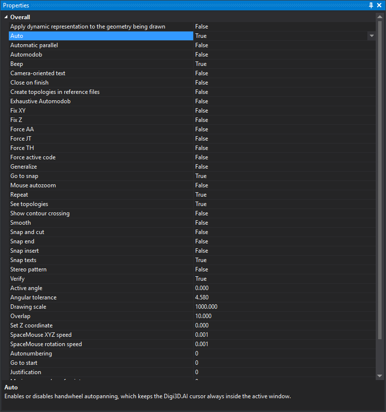

# Properties
<!-- id: propiedades -->
<!-- origen: d60fc6102fcbf6bfcdf9e8807efc479f9b4713b5 -->

This pane shows and changes variable command values. Changing a value has the same effect as running the command with that value.

It includes Digi3D.AI's variable commands and those of loaded extensions:

* [Boolean variables](../ordenes/variables/variables-booleanas.md), with **True** and **False** values.
* [Real variables](../ordenes/variables/variables-reales.md), with three decimal places.
* [Numeric variables](../ordenes/variables/variables-numericas.md), with integers.

The lower area describes the selected command.

## Showing the pane

Show it in either way:

* Click its button on the [Panes toolbar](../barras-de-herramientas/paneles.md).
* Select **Window/Other windows/Properties**.
