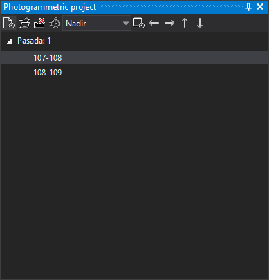

# Photogrammetric project
<!-- id: proyecto-fotogrametrico -->
<!-- origen: bbb7fa73d8535c3da03574581c44bb81a400274c -->

Creates photogrammetric project files and loads projects created by other programs.

A loaded project appears as a tree with one branch per strip listed in the project file and one leaf per model.

Clicking a model opens a photogrammetric window with it. If a photogrammetric window is already open, the selected model replaces its current model.

A project containing photos rather than models shows two lists with the same photos, left and right. Selecting one photo in each loads their model.

A `.d3dprj` can contain **RPC Satellite (stereoscopic)** pairs (RPC: rational polynomial coefficients) instead of conical camera models. See [Projects with multiple pairs](../ventana-fotogrametrica/sensores/rpc/README.md#projects-with-multiple-pairs) for creating a multi-pair `.d3dprj` and how automatic model switching chooses a pair.

The pane saves the last project path loaded with **New**, **Load** or Python's [open_project](../../programacion/python/referencia/digi3d/functions.md#open_project). Digi3D.AI loads no project at startup unless the command line includes `proyecto` or startup opens a drawing file with an associated project.

## Project associated with the drawing file

With **Configuration**'s [Store the photogrammetric project or the photogrammetric model as a reference file](../cuadros-de-dialogo/configuracion/archivos-de-referencia/almacenar-el-proyecto-o-el-modelo-fotogrametrico.md) enabled, loading through **New**, **Load** or `open_project` associates the project with the last focused drawing window's file, if any drawing window is open: its path is saved in that drawing file's [reference file list file](../archivos/archivo-de-archivos-de-referencia.md#photogrammetric-project-or-model), unless the drawing file is read-only. When the active photogrammetric window loads a project model, Digi3D.AI also saves its name and viewpoint. The option is disabled by default.

With **Store the photogrammetric project or the photogrammetric model as a reference file** enabled, opening a drawing file with an associated project loads it if the pane has no project. If another project is loaded, Digi3D.AI asks whether to replace it with the drawing file's project. If the reference file list specifies a model, loading it depends on the conditions described in that section. [Photogrammetric project or model](../archivos/archivo-de-archivos-de-referencia.md#photogrammetric-project-or-model) lists cases where the associated project is not loaded. If each work area has its own drawing file and project, associate each pair once: enable **Store the photogrammetric project or the photogrammetric model as a reference file**, activate that area's writable drawing file window and load the project.

With **Store the photogrammetric project or the photogrammetric model as a reference file** enabled, **Load**'s file dialog proposes the project associated with the last focused drawing window's file, if one is associated. It proposes the last loaded project if the option is disabled, no drawing window is open or the last focused drawing file has no associated project.

## Models that cannot be loaded

By default the tree shows only loadable models. Each unavailable model adds “Model file: *model* not located.” to [Tasks](tareas.md). If no project model can be loaded, Digi3D.AI displays “No model of the project file could be loaded. Possibly the path to the images in the project file is invalid.”

Disabling [Show only loaded models](../cuadros-de-dialogo/configuracion/proyecto-fotogrametrico/mostrar-solo-modelos-cargados.md) also shows unavailable models, disabled; each still adds its error to Tasks.

## Project coordinate reference system

Loading a project without an associated reference system displays “We have not located the coordinate reference system of this project” with three options:

* **I know the coordinate reference system of this project and I want to indicate what is.**: opens coordinate reference system selection and, on acceptance, creates a `.prj` beside the project.
* **I don't know the coordinate reference system of this project.**: creates a `.prj` with an unknown system.
* **I would like to ask me next time.**: temporarily assigns an unknown system without creating a `.prj`.

### Vertical system

Only Inpho and PhotoScan projects show this dialog. If the project system has only a horizontal component and [Ask for sensor's vertical system](../cuadros-de-dialogo/configuracion/sistema-de-referencia-de-coordenadas/solicitar-sistema-vertical-para-sensores.md) is **Yes**, loading displays **Unknown vertical coordinate system**, as for a [model without a vertical system](../ventana-fotogrametrica/sensores/camara-conica/sistema-de-referencia-del-modelo.md#vertical-coordinate-reference-system). Two options are offered:

* **I know the Vertical coordinate reference system of this model and I want to indicate it**: opens vertical reference system selection. The project uses its horizontal system with the selected vertical system. Cancelling selection acts as the next option.
* **I don't know the vertical coordinate reference system of this model.**: uses the file's horizontal system with an unknown vertical system. Digi3D.AI does not transform Z.

Although option text says the file will change, Digi3D.AI writes nothing to the project: the choice is not saved and the dialog reappears each time the project is loaded.

An Inpho project may declare an Esri system in `$COORDINATE_SYSTEM` with a `VERTCS` after `PROJCS`, for example `PROJCS["ETRS_1989_UTM_Zone_30N",…],VERTCS["EGM2008_Geoid",…]`. If both are recognized as EPSG systems, the equivalent compound system is used (ETRS89 / UTM zone 30N + EGM2008 height in the example) without showing the dialog.

## Project loading errors

* “We have not located any extension that allows you to open the selected file.”: no installed sensor recognizes it.
* “The project file does not provide any viewpoint, so no model can be loaded from it.”
* “A project cannot be loaded while a model is being loaded in the background. Wait until it finishes.”

## Toolbar

The toolbar controls pane contents.

### Buttons

* **New**: creates a photogrammetric project file.
* **Load**: loads an existing project. Without a photogrammetry license, loads nothing.
* **Unload**: unloads the project.

**Load** and **Unload** are disabled while a model loads in the background.
* **Automatic model change**: toggles automatic model switching.
* **Viewpoint**: selects a viewpoint if the loaded project provides several from one station.
* **Open in new window**: when enabled, clicking a model opens a new photogrammetric window rather than replacing the active window's model.
* **Go to previous model** and **Go to next model** (left and right arrows): load the previous or next model in the same strip into the active photogrammetric window.
* **Go to the previous strip model** and **Go to the next strip model** (up and down arrows): load the most suitable model in the previous or next strip for the cursor position.

Arrow buttons are enabled only with a loaded project and an open photogrammetric window.

A photogrammetric window opened with a point cloud or stereoscopic orthophoto model does not load another model in the background. If the active photogrammetric window was opened with a point cloud or stereoscopic orthophoto model, clicking a model opens it in a new photogrammetric window, even with **Open in new window** disabled, and the arrows do not load any model.

## Showing the pane

Show it in either way:

* Click its button on the [Panes toolbar](../barras-de-herramientas/paneles.md).
* Select **Window/Photogrammetric project**.
