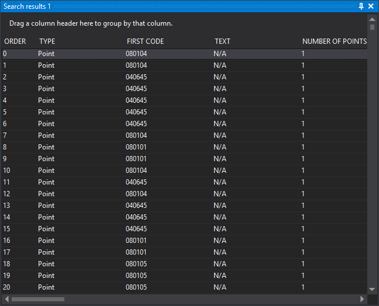

# Search results 1 and 2
<!-- id: resultados-de-la-busqueda-1-y-2 -->
<!-- origen: 5a86e27511b531672364e83e5c678a3aeb00d521 -->

Show geometries found through [Search](buscar.md). Two identical panes let you retain results from two searches at once.

Each row is a geometry. **Order** and **Type** are always shown. Configure other columns under [Search results](../cuadros-de-dialogo/configuracion/resultados-de-la-busqueda/README.md).

## Interaction

* **Double-click** a result: temporarily selects the geometry in the drawing window for the [configured duration](../cuadros-de-dialogo/configuracion/resultados-de-la-busqueda/segundos-a-mostrar-la-entidad-seleccionada.md) and performs the [configured action](../cuadros-de-dialogo/configuracion/resultados-de-la-busqueda/accion-al-hacer-doble-clic.md): zoom to geometry extents, move the camera to its center or retain the view.
* **Click a column header**: sorts by that column.
* **Drag a column header** to the upper area: groups results by that column.
* **Drag a column header** out of the header area: removes that column.
* **Context menu, Send selection to the active command**: passes selected results to the current command if it supports geometry selection. Use **Ctrl** and **Shift** for multiple results. A command supporting only one geometry receives the first selected result. Deleted geometries are omitted unless [DELETED](../ventana-de-dibujo/variables/b/borrados.md) is 1.

Results belong to the drawing window where the search ran: double-clicking and the context menu do nothing while another drawing window is active. The pane is cleared when its window closes or its results' drawing file is discarded.

## Showing the pane

Show it in either way:

* Click its button on the [Panes toolbar](../barras-de-herramientas/paneles.md).
* Select **Window/Search results/Search results 1** or **Window/Search results/Search results 2**.
