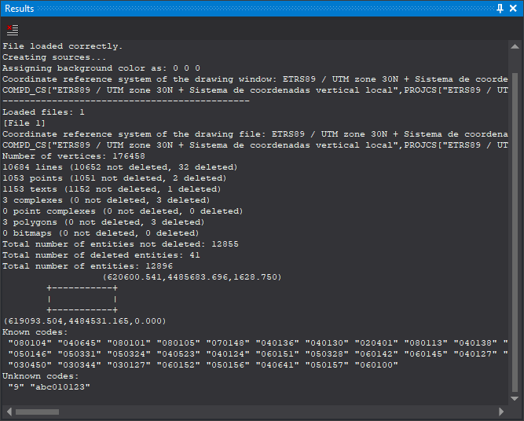

# Results
<!-- id: resultados -->
<!-- origen: 769db7c46927f85eb043e78635b3e3cff9558302 -->

This pane shows Digi3D.AI messages and results written by commands such as [BININFO](../ventana-de-dibujo/ordenes/b/bininfo.md). Each message is appended. Some also scroll the pane to the end; others are added without scrolling.

## Toolbar

* **Clear**: clears pane contents.

## Clearing from the menu

**Window/Results/Clear results** runs [DELETE_OUTPUT_BAR](../ventana-de-dibujo/ordenes/b/borra-barra-salida.md), clearing the pane. Enabled only if it contains text; acts only while a drawing window is open.

## Showing the pane

Show it in any of these ways:

* Click its button on the [Panes toolbar](../barras-de-herramientas/paneles.md).
* Select **Window/Results/Results**.
* Press Alt+Shift+R.
