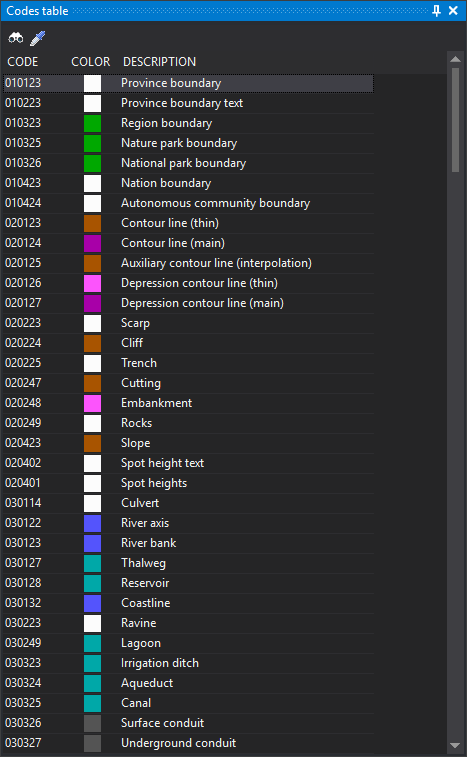

# Code table
<!-- id: tabla-de-codigos -->
<!-- origen: 076f8c675244792feb2a4d59dff39dc069378670 -->

This pane shows all codes in the active code table and selects the active code with a click. It serves the same purpose as the [Code toolbar](../barras-de-herramientas/codigo.md), with all codes visible.

Clicking a code makes it active in the active drawing window.

The pane is enabled only when **Code panel (single-coding)** is selected under [Interface for selecting codes](../cuadros-de-dialogo/configuracion/diging/interfaz-para-seleccionar-codigo.md). Restart Digi3D.AI for the change to take effect. The option is named “Code panel”, while the pane it creates is titled **Code table**.

## Toolbar

Buttons are enabled only while a drawing window is open.

* **Select code**: runs [COD](../ventana-de-dibujo/ordenes/c/cod.md), selecting the active code in a dialog.
* **Copy entity code**: runs [CLONAR_CODIGOS](../ventana-de-dibujo/ordenes/c/clonar-codigos.md), assigning the selected entity's code as active.

## Columns

* **Code**: code name.
* **Color**: code color in the code table.
* **Description**: code description in the code table.

## Showing the pane

Select **Window/Code table**.
