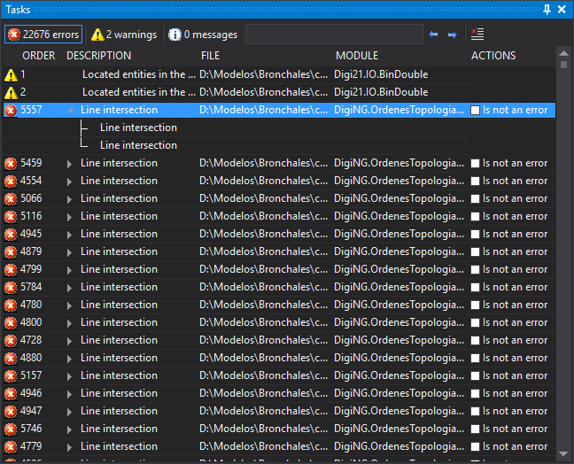

# Tasks
<!-- id: tareas -->
<!-- origen: 5e6061f864e56cf1b4a96a818584ed3f06ff3590 -->

This pane displays tasks (errors, warnings, and messages) generated by commands such as [DETECT_NO_CONNECTED_LINES](../ventana-de-dibujo/ordenes/d/detectar_lineas_no_conectadas.md) or topological control commands, and by some importers when loading a drawing file.

Double-click a task to execute its action: center an entity in the drawing window, zoom to an entity, display a dialog box, and so on. Some tasks also have a context menu with additional options, opened by right-clicking.

## Columns

| Column | Description |
| ----------- | ----------- |
| (untitled) | Icon indicating whether the task is an error, warning, or message. This column has an empty header; hovering over it displays "Category". |
| Command | Task number in generation order. |
| Description | Task description. |
| File | Drawing file containing the entity that generated the task. |
| Unit | Digi3D.AI extension that generated the task. |
| Actions | **Is not an error** checkbox, for tasks supporting it. |

Click a column title to sort tasks by that column in ascending or descending order.

When a command sends a task list together and requests sorting, identical tasks are grouped: the first shows an arrow to the left of the description; expand it to show the others as subtasks. Tasks arriving individually are not grouped.

## Is not an error

Selecting **Is not an error** adds the task and its subtasks to `tareasdescartadas.txt`. The task remains in the pane. Tasks in that file are not displayed when generated again. Clearing the checkbox removes the task from the file.

`tareasdescartadas.txt` is in the folder of the last drawing file opened. It is read when opening the drawing file.

## Toolbar

* **Errors**, **Warnings**, and **Messages**: show task counts for each type, including subtasks. Click to show or hide tasks of that type.
* **Search**: text entry box. Press Enter to select the next task whose description contains the text. The search is case-sensitive.
* **Previous** and **Next**: select the previous or next task whose description contains the text in **Search**.
* **Delete tasks**: remove all tasks from the pane.

## Show the pane

Show the pane in any of these ways:

* Click its button on the [Panels toolbar](../barras-de-herramientas/paneles.md).
* Select **Window/Tasks/Tasks**.
* Press Alt+Shift+T.

**Window/Tasks/Delete tasks** runs [DELETE_TASKS](../ventana-de-dibujo/ordenes/b/borrar-tareas.md). It is enabled only if the pane contains tasks.

## Related commands

* [DELETE_TASKS](../ventana-de-dibujo/ordenes/b/borrar-tareas.md).
* [LOAD_TASKS](../ventana-de-dibujo/ordenes/c/cargar-tareas.md).
* [SAVE_TASKS](../ventana-de-dibujo/ordenes/g/guardar-tareas.md).
* [TAREA+](../ventana-de-dibujo/ordenes/t/tarea-mas.md).
* [TAREA-](../ventana-de-dibujo/ordenes/t/tarea-menos.md).
