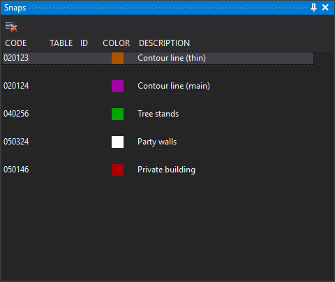

# Snaps
<!-- id: panel-tentativos -->
<!-- origen: 2cba538ee86e4a2ace3b9e9ecd84eaf0e5ba5a61 -->

This pane shows the code history of entities found with the mouse tentative button. Each entity adds its codes at the top, separated from the previous entity by an empty row, so the most recent appears first. All codes of a multi-code entity appear.

Double-clicking a code makes it active in the drawing window.

## Columns

* **Code**: code name.
* **Table** and **ID**: associated database table and record number, when working with a database.
* **Color**: code color in the code table.
* **Description**: code description in the code table.

## Toolbar

* **Clear**: empties the list. Enabled only if a drawing window is open and the list has at least one code.

## Showing the pane

Show it in either way:

* Select **Window/Snaps**.
* Press Alt+Shift+S.

## See also

* [Tentative selection message bar and pane](../../primeros-pasos/comenzando-a-utilizar-digi3d.ai/comenzando-con-la-ventana-de-dibujo/barra-mensajes-al-tentativar.md)
