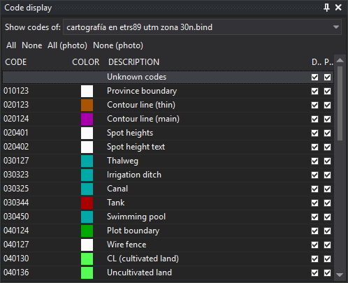

# Code display
<!-- id: visualizacion-de-codigos -->
<!-- origen: b3460a1e41edd3edc0eb21eab6f06ce9a38d69c8 -->

This pane enables or disables each code's display separately in the drawing and photogrammetric windows, for each loaded drawing file.

## Toolbar

* **Show codes of:**: drawing file whose codes are shown. The drop-down contains the main drawing file and loaded reference files.
* **All** and **None**: enable or disable all file codes in the drawing window.
* **All (photo)** and **None (photo)**: enable or disable all file codes in the photogrammetric window.

## Columns

* **Code**: code name.
* **Color**: code color in the code table.
* **Description**: code description in the code table.
* **Drawing window**: checkbox enabling or disabling code display in the drawing window.
* **Photogrammetric window**: checkbox enabling or disabling code display in the photogrammetric window.

## Codes shown

* If the drawing file accepts new geometries, all code table codes appear, so a code can be disabled before any geometry uses it.
* If the file is read-only or cannot store geometries, such as a WMS server connection, only codes from its geometries appear. A WMS connection has no geometries, so its list is empty and the pane displays “This drawing file has no geometries.”
* Adding a geometry with an unlisted code adds that code to the list.
* Codes absent from the code table are omitted.

## Showing the pane

Show it in either way:

* Select **Window/Code display**.
* Press Alt+Shift+V.

The [Panes toolbar](../barras-de-herramientas/paneles.md) has no button for this pane.

## Related commands

The same operations are available through [OND](../ventana-de-dibujo/ordenes/o/ond.md), [OFFD](../ventana-de-dibujo/ordenes/o/offd.md), [ONS](../ventana-de-dibujo/ordenes/o/ons.md) and [OFFS](../ventana-de-dibujo/ordenes/o/offs.md).
