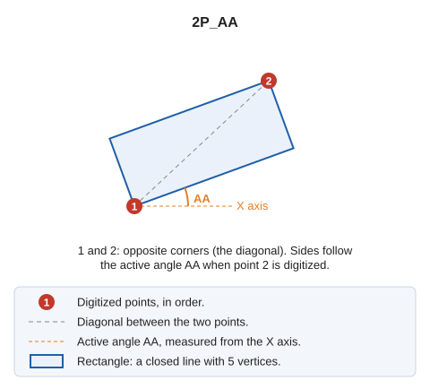

# 2P_AA
<!-- id: 2p-aa -->
<!-- origen: 06f77aae2b2dc93890033712055e8cdaf114fde2 -->

Draw a rotated rectangle.

## Parameters

Does not accept parameters.

## Notes

This command prompts you to [enter](../../introduccion-de-coordenadas.md) two points at opposite corners of the rectangle, defining a diagonal.

The sides of the rectangle follow the [active angle](../../variables/a/aa.md) set when you digitize the second point. The [RECTANGLE\_2P\_NORTH](/digi3d-ai/referencia/ventana-de-dibujo/ordenes/r/rectangulo-2p-norte.md) command draws a rectangle at an angle of 0 degrees, with its sides parallel to the axes.

## Command characteristics

| Command type                                    | [Interactive command](../../../ordenes/ordenes-interactivas.md)        |
| ------------------------------------------------ | -------------------------------------------------------------------- |
| Repeats automatically                           | Yes |
| Menu option           | Draw/More/Rectangle with 2 points and active angle                |
| Toolbar | Squares and rectangles                                              |
| Extension                                        | DigiNG.OrdenesStandard.dll                                             |
| Implementation | Native |
| Related variables                           | [AA](/digi3d-ai/referencia/ventana-de-dibujo/variables/a/aa.md) — active angle [REPEAT](/digi3d-ai/referencia/ventana-de-dibujo/variables/r/repite.md) — repeat the last command executed |
| Related commands                             | [2P](/digi3d-ai/referencia/ventana-de-dibujo/ordenes/2/2p.md) [3P](/digi3d-ai/referencia/ventana-de-dibujo/ordenes/3/3p.md) [RECTANGLE\_2P\_NORTH](/digi3d-ai/referencia/ventana-de-dibujo/ordenes/r/rectangulo-2p-norte.md) [RECTANGLE\_DR](/digi3d-ai/referencia/ventana-de-dibujo/ordenes/r/rectangulo-dr.md) |
| Internal name | {63DCF587-DB76-4992-B84E-F1729BBDF3DC} |

## Video

<video controls><source src="https://digi21.blob.core.windows.net/videos-ayuda/2P_AA.mp4" type="video/mp4"></video>
