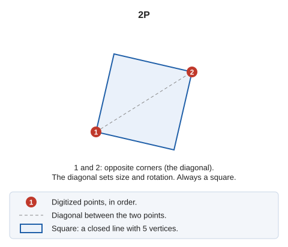

# 2P
<!-- id: 2p -->
<!-- origen: 804ed75b523d395e8171eef43354b7d789fe64d2 -->

Draw a square from two points.

## Parameters

Does not accept parameters.

## Notes

The command prompts you to [enter](../../introduccion-de-coordenadas.md) two points at opposite corners of the square, defining a diagonal. It calculates the size and rotation of the square from these two points.

The result is a square formed by a closed line with 5 points, where the first and last points coincide.

## Command characteristics

| Command type | [Interactive command](../../../ordenes/ordenes-interactivas.md) |
| :--- | :--- |
| Repeats automatically | Yes |
| Menu option | Draw/More/Square with 2 points |
| Toolbar | Squares and rectangles |
| Extension | DigiNG.OrdenesStandard.dll |
| Implementation | Native |
| Related variables | [REPEAT](/digi3d-ai/referencia/ventana-de-dibujo/variables/r/repite.md) — repeat the last command executed |
| Related commands | [2P\_AA](/digi3d-ai/referencia/ventana-de-dibujo/ordenes/2/2p-aa.md) [3P](/digi3d-ai/referencia/ventana-de-dibujo/ordenes/3/3p.md) [RECTANGLE\_2P\_NORTH](/digi3d-ai/referencia/ventana-de-dibujo/ordenes/r/rectangulo-2p-norte.md) [RECTANGLE\_DR](/digi3d-ai/referencia/ventana-de-dibujo/ordenes/r/rectangulo-dr.md) |
| Internal name | {4F444510-6B05-4072-AFA2-D258FD9BA46D} |

## Video

<video controls><source src="https://digi21.blob.core.windows.net/videos-ayuda/2P.mp4" caption="" type="video/mp4"></video>
