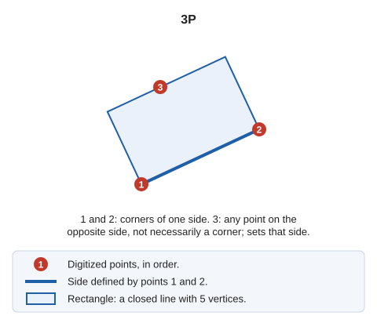

# 3P
<!-- id: 3p -->
<!-- origen: c4e4f170d1f546e7fafb9dcdcf2e2a9c62ffcf48 -->

Draw a rectangular shape.

## Parameters

Does not accept parameters.

## Notes

Enter 3 points: the first two define the corners of one side, and the third can be any point on the opposite side \(it does not have to be a corner\).

You can define the points graphically or with the [XY](/digi3d-ai/referencia/ventana-de-dibujo/ordenes/x/xy.md) command.

The result is a rectangle defined by 5 points \(4 + 1\): the first and last points coincide to close the entity.

As you digitize the points, the application displays the horizontal distance, the differences in X and Y coordinates, and the slope distance.

## Command characteristics

| Command type | [Interactive command](/digi3d-ai/referencia/ordenes/ordenes-interactivas.md) |
| :--- | :--- |
| Repeats automatically | Yes |
| Menu option | Draw/More/Rectangle with 3 points |
| Toolbar | Squares and rectangles |
| Extension | DigiNG.OrdenesStandard.dll |
| Implementation | Native |
| Related variables | [REPEAT](/digi3d-ai/referencia/ventana-de-dibujo/variables/r/repite.md) — repeat the last command executed |
| Related commands | [2P](/digi3d-ai/referencia/ventana-de-dibujo/ordenes/2/2p.md) [2P\_AA](/digi3d-ai/referencia/ventana-de-dibujo/ordenes/2/2p-aa.md) [RECTANGLE\_2P\_NORTH](/digi3d-ai/referencia/ventana-de-dibujo/ordenes/r/rectangulo-2p-norte.md) [RECTANGLE\_DR](/digi3d-ai/referencia/ventana-de-dibujo/ordenes/r/rectangulo-dr.md) |
| Internal name | {D7959DEC-5FFF-436a-A9CE-AB2A199ECE12} |
