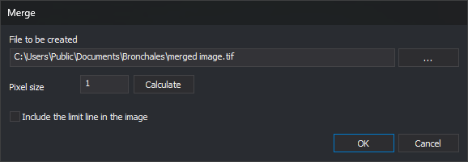
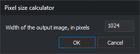

# MERGE_RASTER
<!-- id: acoplar -->
<!-- origen: 54b5fadcdcb1c9cdde5ce028442d14e2753a6866 -->

Generate a TIFF file showing, with their symbology, the entities from visible drawing files that fall within a rectangular boundary line.

## Parameters

Does not accept parameters.

## Notes

The command prompts you to select the boundary line. The line must be a rectangle with at least 4 vertices: the image width is the length of the side between vertices 1 and 2, and its height is the length of the side between vertices 2 and 3. The rectangle can be rotated; the image follows the orientation of the side between vertices 1 and 2. If the selected entity is not a line or has fewer than 4 vertices, the command does nothing.

The command then displays this dialog box:

* **File to be created**: path of the TIFF (Tag Image File Format) file to generate. Click **...** to choose the path.
* **Pixel size**: pixel size in coordinate reference system units. Click **Calculate** to open the pixel size calculator, which calculates the pixel size from the desired image width in pixels:

  

* **Include the limit line in the image**: if unchecked, the command hides the boundary line while generating the image.

The generated file is an uncompressed RGB TIFF with an alpha channel, 8 bits per channel, and 256 × 256 pixel tiles. The command does not write georeferencing information to the file or draw loaded raster images. If the file cannot be created, the command displays an error message and finishes.

## Command characteristics

| Command type | [Interactive command](/digi3d-ai/referencia/ordenes/ordenes-interactivas.md) |
| :--- | :--- |
| Repeats automatically | No |
| Menu option | _This command has no associated menu option_ |
| Toolbar | _This command has no associated toolbar button_ |
| Extension | DigiNG.OrdenesRaster.dll |
| Implementation | Native |
| Related variables | No related variables |
| Related commands | [CAPTURE\_DRAWING\_WINDOW](/digi3d-ai/referencia/ventana-de-dibujo/ordenes/c/captura-ventana-dibujo.md) |
| Internal name | {268A27C0-D187-4244-AE47-3DB2A0319D27} |
