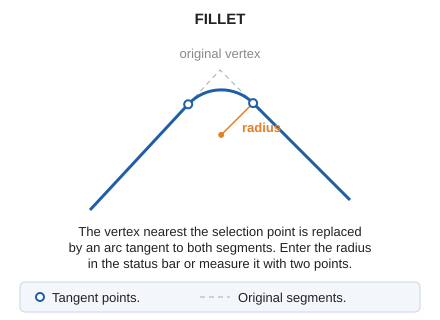

# FILLET
<!-- id: acuerdo -->
<!-- origen: c156445588eb4b187750155d935f5571ffb5e9b1 -->

Draw a circular fillet between two segments of an entity sharing a vertex.

## Parameters

Does not accept parameters.

## Notes

1. Select the line near the vertex to round. The command uses the vertex nearest the selection point, which cannot be the line's first or last vertex.
2. Specify the radius in either of these ways:
   - Enter the radius in meters in the status bar's **Radius** field and press Enter.
   - Digitize two points: the radius is their plan distance. If the drawing window's horizontal coordinate reference system is geographic, this is the geodesic distance on the ellipsoid, in meters, between the two points, whose longitude and latitude are interpreted in the system's angular unit. For more information, see [Coordinates, distances, angles, and areas for commands run in the drawing window](/digi3d-ai/sistemas-referencia-coordenadas/implementacion-src-modulos-digi3d/ventana-dibujo/coordenadas-distancias-angulos-ventana-dibujo.md).

The vertex is replaced by an arc of the specified radius, tangent to both adjoining segments. Tangent point Z coordinates are interpolated along each segment.

If the radius is so large that a tangent point lies outside its segment, the command displays **The fillet cannot be completed with the data provided.** and leaves the line unchanged.

If quality control rejects the modified entity, the original entity is preserved unchanged.

## Command characteristics

| Command type | [Interactive command](/digi3d-ai/referencia/ordenes/ordenes-interactivas.md) |
| :--- | :--- |
| Repeats automatically | Yes |
| Menu option | Edit/Polylines/Round off a vertex |
| Toolbar | Edit polyline |
| Extension | DigiNG.OrdenesStandard.dll |
| Implementation | Native |
| Related variables | [REPEAT](/digi3d-ai/referencia/ventana-de-dibujo/variables/r/repite.md) — repeat the last command executed |
| Related commands | [ARC](/digi3d-ai/referencia/ventana-de-dibujo/ordenes/a/arco.md) |
| Internal name | {63EDB2B3-4DC6-4584-9EFC-AAE939D3FFB3} |
