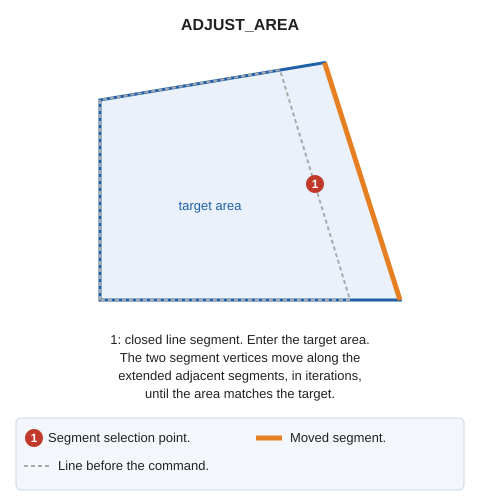

# ADJUST\_AREA
<!-- id: ajusta-area -->
<!-- origen: 741d7fbbc3cc887678b7a625e82d45cc9b32b3dd -->

Move the selected segment to adjust the area of the selected closed line to the target area.

## Parameters

| Parameter number | Description | Optional |
| :--- | :--- | :--- |
| 1 | Maximum number of iterations (default: 100) | Yes |
| 2 | Sigma: tolerance for the absolute difference between the target and calculated areas, in squared coordinate reference system units | Yes |

If quality control rejects the modified entity, the original entity is preserved unchanged.

## Command characteristics

| Command type | [Interactive command](/digi3d-ai/referencia/ordenes/ordenes-interactivas.md) |
| :--- | :--- |
| Repeats automatically | No |
| Menu option | _This command has no associated menu option_ |
| Toolbar | _This command has no associated toolbar button_ |
| Extension | DigiNG.OrdenesStandard.dll |
| Implementation | Native |
| Related variables | No related variables |
| Related commands | No related commands |
| Internal name | {03678D49-92C8-4F25-BC8A-6F386BD08F5B} |
