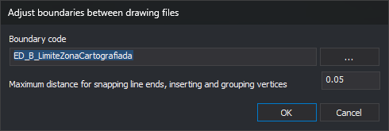

# ADJUST\_DRAWING\_FILE\_LIMITS
<!-- id: ajusta-limites-archivos-dibujo -->
<!-- origen: 4da57ad9da67f61b11d93804b054c4b4e1591a0f -->

Adjust boundaries between adjacent drawing files: snap nearby dangling line endpoints to boundaries, insert boundary vertices where lines arrive and other file boundaries approach, group nearby boundary vertices, and move coincident vertices of all entities with those groups.

## Parameters

| Parameter number | Description | Optional |
| :--- | :--- | :--- |
| 1 | Code of boundary lines between drawing files. Supports `?` and `*` | No |
| 2 | Maximum distance in drawing coordinate units. Must be greater than 0, using a period as decimal separator | No |

With fewer than two parameters, all are ignored and the dialog opens. An empty code plays the error sound, displays **Specify the code of the boundary lines.**, and ends. An invalid distance plays the error sound, displays **The distance must be a number greater than 0.**, and ends. Neither case changes anything.

## Notes

At least two drawing files must be loaded, counting active and reference files. Otherwise, the error sound plays, **At least two drawing files are needed to adjust the boundaries.** appears, and the command ends.

### Dialog

**Adjust boundaries between drawing files** contains:

| Control | Description |
| :--- | :--- |
| Boundary code | Boundary line code, usually each sheet frame. **...** opens code selection and copies the first chosen code. Canceling retains the field value |
| Maximum distance for snapping line ends, inserting and grouping vertices | Distance in drawing coordinate units used throughout adjustment. Defaults to 0.05 |

**OK** validates input. An empty code displays **Specify the code of the boundary lines.**. A distance that is not a number greater than 0 using a decimal period displays **The distance must be a number greater than 0.**. The dialog stays open with focus in the invalid field.

Valid code and distance are saved as `CodigoLimite` and `Distancia` under registry key `HKEY_CURRENT_USER\Software\Digi21\Digi3D.NET\DigiNG\Extensiones\DigiNG.OrdenesTopololgia\DialogoAjustarLimitesArchivosDibujo`, and restored on the next run. Parameter mode saves nothing.

**Cancel** ends without changes.

### Adjustment

Boundary lines are undeleted lines with the boundary code among their codes. Matching is case-sensitive, supports `?` \(any character\) and `*` \(the remaining code\), and does not support `#` tags. Polygons with that code are not boundaries.

Every pair of loaded drawing files is processed, including reference files. With three or more files, each file is processed once with each other file. For each pair:

1. **Endpoint adjustment.** In each file separately:
   * Delete two-vertex lines with a dangling endpoint and horizontal length below the distance. This affects all visible lines, whether near a boundary or not.
   * Move each dangling endpoint of a visible line to that same file boundary if no farther than the specified distance, measured separately in X and Y. If a boundary vertex is within range, use it; otherwise, use the perpendicular foot on the segment. A dangling endpoint shares no position with another line endpoint. X and Y change; Z is retained.
2. **Vertices where lines reach boundaries.** In each file, insert a boundary vertex wherever a visible line from that file touches or crosses it. Only boundary lines change. New vertex Z is interpolated along the boundary segment.
3. **Vertices between boundaries.** Across both files, insert a vertex where another boundary crosses a boundary, or where a vertex of another boundary lies less than the distance from one of its segments. The new vertex takes that vertex X and Y, with Z interpolated on the segment.
4. **Vertex grouping.** Group boundary vertices from both files less than the horizontal distance apart, calculating the mean position of each group. Visit all undeleted entities in both files, of every code and type, visible or hidden, and move vertices coinciding with grouped vertices to the mean position. Only X and Y change.

Steps 1–3 consider only visible lines, excluding disabled codes and lines outside the area of interest.

Points coincide if X and Y differences are below **Sigma** on the project [Drawing file](/digi3d-ai/referencia/cuadros-de-dialogo/nuevo-proyecto/archivo-de-dibujo.md) tab \(0.001 by default\).

After step 2, each line reaching its file boundary ends at a boundary vertex. Running this command before [DETECT\_LINE\_CONTINUITY\_ERRORS\_CASES](/digi3d-ai/referencia/ventana-de-dibujo/ordenes/d/detectar-errores-continuidad-lineas-cases.md) allows that command to analyze every line reaching the boundary.

Each modified entity is replaced by a copy: the original is deleted and the copy added to the same file. To write a reference file, the command temporarily makes it active without a file-change warning, restoring the initially active file when finished.

No completion message appears, even if no boundary lines are found. All changes form one operation, reversed together by **Undo**.

If Digi3D.AI rejects any new entity, its part of the adjustment is not applied and the originals for that part are retained. Other parts proceed normally.

## Command characteristics

| Command type | Immediate command |
| :--- | :--- |
| Repeats automatically | No |
| Menu option | Geometric analysis/Adjust boundaries between drawing files... |
| Toolbar | _This command has no associated toolbar button_ |
| Extension | DigiNG.OrdenesTopologia.dll |
| Implementation | Native |
| Related variables | No related variables |
| Related commands | [TOPOLOGICAL\_CONTROL\_CASES](/digi3d-ai/referencia/ventana-de-dibujo/ordenes/c/control-topologico-cases.md) [DETECT\_BBDD\_ATTRIBUTE\_ERRORS\_CASES](/digi3d-ai/referencia/ventana-de-dibujo/ordenes/d/detectar-errores-atributos-bbdd-cases.md) [DETECT\_LINE\_CONTINUITY\_ERRORS\_CASES](/digi3d-ai/referencia/ventana-de-dibujo/ordenes/d/detectar-errores-continuidad-lineas-cases.md) |
| Internal name | {F42F2BF5-3153-48EB-A78F-B59921A4E5EC} |
