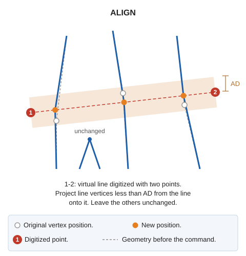

# ALIGN
<!-- id: alinear -->
<!-- origen: 9f29ebd2f14789e3ac7d6715315f21e4de1483fa -->

Move vertices whose distance to a digitized virtual line is less than or equal to the [primary active distance](/digi3d-ai/referencia/ventana-de-dibujo/variables/d/da.md).

## Parameters

Does not accept parameters.

## Notes

Use this command to align line segments. Digitize a virtual line using two points. Locate all vertices less than the _primary active distance_ from it and project those vertices onto the virtual line.

Handle each entity independently: if Digi3D.AI rejects an aligned entity, retain its original. Accepted entities are aligned.

## Command characteristics

| Command type | [Interactive command](/digi3d-ai/referencia/ordenes/ordenes-interactivas.md) |
| :--- | :--- |
| Repeats automatically | Yes |
| Menu option | Edit/Polylines/Align line vertices (2 points) |
| Toolbar | _This command has no associated toolbar button_ |
| Extension | DigiNG.OrdenesStandard.dll |
| Implementation | Native |
| Related variables | [AD](/digi3d-ai/referencia/ventana-de-dibujo/variables/d/da.md) — active distance [REPEAT](/digi3d-ai/referencia/ventana-de-dibujo/variables/r/repite.md) — repeat the last command executed |
| Related commands | No related commands |
| Internal name | {DA40261D-4120-4d7b-8D1E-B8EC7423D95D} |
