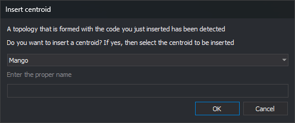

# ADD\_ACTIVE\_CODES\_AND\_CENTROID
<!-- id: anade-codigos-activos-y-centroide -->
<!-- origen: b07550585b27a015e6c0501ead12d5d96bc71d38 -->

Add active codes to boundary lines of selected enclosures in the topology for flooding and, if a code table topology is formed from the active code, insert a centroid in the enclosure.

## Parameters

Does not accept parameters.

## Notes

This flooding command acts on enclosures you click and requires a topology for flooding loaded in memory. First generate it with [GENERATE\_FLOOD\_TOPOLOGY](/digi3d-ai/referencia/ventana-de-dibujo/ordenes/g/generar-topologia-inundacion.md) or [GENERATE\_FLOOD\_TOPOLOGY\_WITHOUT\_ISLANDS](/digi3d-ai/referencia/ventana-de-dibujo/ordenes/g/generar-topologia-inundacion-sin-islas.md), and regenerate it after modifying drawing lines. Without a topology for flooding, the command displays "No temporary topology is created", sounds the error tone, and ends, and **Flooding/Add active codes and centroid...** is disabled. This option is also disabled if the first active code is not the sole code of a code table topology with defined centroids.

### Selecting enclosures

The command displays "Select the area to which active codes are to be added" and highlights the enclosure under the cursor.

* Press the data button inside an enclosure to select it. The previous selection is discarded.
* Hold Ctrl while pressing the data button to add or remove an enclosure from the selection.
* Press the snap button to replace the last selected enclosure with the next unselected enclosure containing the cursor position. If no unselected enclosure contains it, the command removes the last enclosure from the selection and sounds the error tone.
* Press the reset button to clear the selection.
* Press the spacebar to accept the selection. If no enclosure is selected, the command sounds the error tone.
* Press Esc to end the command.

After accepting a selection, the command remains active to select more enclosures.

### Active codes

On acceptance, the command processes lines on the exterior boundaries and holes of the selected enclosures. A line shared by two selected enclosures is not processed because it lies inside the selected area.

The command appends any active codes the line does not have to each line's code list. If the option allowing repeated codes is enabled, it adds the active codes even if the line already has them. A line receiving no codes is not modified. Each modified line is replaced with a new line with the same vertices, and the topology for flooding and loaded topologies of the active drawing file use the new line.

### Dialog box

After adding codes, if there is a single active code, the command searches the code table for [topologies](/digi3d-ai/referencia/editor-de-tablas-de-codigos/pestanas/topologias/README.md) whose sole code is the active code and that have defined [centroids](/digi3d-ai/referencia/editor-de-tablas-de-codigos/pestanas/topologias/centroide.md). For each matching topology, the command displays _Insert centroid_. With multiple active codes, the dialog box is not displayed.

The drop-down contains centroids of the topology being processed, in alphabetical order. Each centroid appears with its description or, if none is defined, its text. When Insert centroid opens, the first centroid is selected.

_Enter the proper name_ is enabled only if the selected centroid is [variable](/digi3d-ai/referencia/editor-de-tablas-de-codigos/pestanas/topologias/anadir-centroide.md#variable), for example, to enter street names.

Click _Accept_ to insert text at an interior point of the first selected enclosure:

* Its content is the centroid text. For a variable centroid, the entered proper name follows the centroid text without a separator.
* It uses the [text height](/digi3d-ai/referencia/ventana-de-dibujo/variables/a/at.md), [text justification](/digi3d-ai/referencia/ventana-de-dibujo/variables/j/jt.md), and [active angle](/digi3d-ai/referencia/ventana-de-dibujo/variables/a/aa.md).
* It has the active codes and active attributes.

If multiple enclosures are selected, the command inserts only one text, in the first enclosure. The text is not added to the topology for flooding.

Click _Cancel_ to omit the text. The codes have already been added to the lines.

### Processed enclosures

Processed enclosures are colored with the selected centroid's fill color. They are gray if the centroid has no fill color, if you click _Cancel_, or if the command does not display Insert centroid. Markers of processed enclosures remain after ending the command with Esc.

[UNDO](/digi3d-ai/referencia/ventana-de-dibujo/ordenes/u/undo.md) undoes the codes added and text inserted when accepting a selection in a single operation.

## Command characteristics

| Command type | [Interactive command](/digi3d-ai/referencia/ordenes/ordenes-interactivas.md) |
| :--- | :--- |
| Repeats automatically | No. The command remains active after each selection and ends with Esc |
| Menu option | Flooding/Add active codes and centroid... |
| Toolbar | _This command has no associated toolbar button_ |
| Extension | DigiNG.OrdenesTopologia.dll |
| Implementation | Native |
| Related variables | [AA](/digi3d-ai/referencia/ventana-de-dibujo/variables/a/aa.md) — active angle [TH](/digi3d-ai/referencia/ventana-de-dibujo/variables/a/at.md) — text height [JT](/digi3d-ai/referencia/ventana-de-dibujo/variables/j/jt.md) — text justification |
| Related commands | [GENERATE\_FLOOD\_TOPOLOGY](/digi3d-ai/referencia/ventana-de-dibujo/ordenes/g/generar-topologia-inundacion.md) [GENERATE\_FLOOD\_TOPOLOGY\_WITHOUT\_ISLANDS](/digi3d-ai/referencia/ventana-de-dibujo/ordenes/g/generar-topologia-inundacion-sin-islas.md) [DELETE\_COD\_E](/digi3d-ai/referencia/ventana-de-dibujo/ordenes/b/borra-cod-r.md) [EDIT\_CODES\_E](/digi3d-ai/referencia/ventana-de-dibujo/ordenes/e/editar-codigos-r.md) [PUT\_ATR\_E](/digi3d-ai/referencia/ventana-de-dibujo/ordenes/p/poner-atr-r.md) [PUT\_COD\_ENCLOSURE\_CENTROID](/digi3d-ai/referencia/ventana-de-dibujo/ordenes/p/poner-cod-recinto-centroide.md) [UNDO](/digi3d-ai/referencia/ventana-de-dibujo/ordenes/u/undo.md) |
| Internal name | {C37E57E7-6D28-401A-A862-3D96BABD2D0B} |
