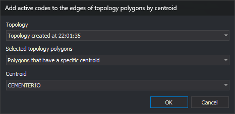

# ADD\_CODES\_TOPOLOGY\_POLYGON\_BORDERS
<!-- id: anadir-codigos-bordes-poligonos-topologia -->
<!-- origen: 91381d7d11889770dc0c92059cb3e825cc159290 -->

Add the active codes to lines forming topology polygon boundaries: all polygons, polygons with any centroid, or polygons with a centroid containing specified text.

## Parameters

This command takes no parameters.

## Notes

At least one topology must be loaded. Otherwise, the menu option is disabled; typing the command displays "No topology loaded", plays the error sound, and ends the command.

### Dialog

The **Add active codes to the edges of topology polygons by centroid** dialog requests:

| Field | Description | Default value |
| :--- | :--- | :--- |
| Topology | Topology to process. Loaded topologies are listed alphabetically by name | First in the list |
| Selected topology polygons | Polygons to process: **All polygons**, **Polygons that have any centroid**, or **Polygons that have a specific centroid** | All polygons |
| Centroid | Centroid text of polygons to process. Lists unique centroid texts alphabetically across all files of the selected topology. Enabled only for **Polygons that have a specific centroid** | None |

Changing topology repopulates the centroid list and clears its selection. **OK** is enabled only when a topology is selected and, with **Polygons that have a specific centroid**, a centroid is also selected.

Values are not remembered: the dialog uses the defaults each time.

**Cancel** ends the command without changing anything.

### Operation

Only the part of the topology belonging to the active drawing file is processed. For each polygon meeting the selected condition, the command adds the active codes to each line forming its outer boundary and holes:

* Centroid matching compares centroid text and is case-sensitive.
* A line shared by two polygons is modified only once. Even if the neighboring polygon does not meet the condition, the shared line receives the codes because it also bounds a polygon that does.
* An active code already present on a line is not added again unless [Allow repeated codes](/digi3d-ai/referencia/cuadros-de-dialogo/configuracion/diging/permitir-codigos-repetidos.md) permits it. If no new codes are added, the line remains unchanged.

Each modified line is replaced by a new line with the same vertices, color, width, and attributes, with the added codes appended. The topology uses the new line, so it remains loaded and the command can be run on it again.

[UNDO](/digi3d-ai/referencia/ventana-de-dibujo/ordenes/u/undo.md) reverses all changes made by the command in one operation.

## Command characteristics

| Command type | Immediate command |
| :--- | :--- |
| Repeats automatically | No |
| Menu option | Topology/Add active codes to topology polygon edges... |
| Toolbar | _This command has no associated toolbar button_ |
| Extension | DigiNG.OrdenesTopologia.dll |
| Implementation | Native |
| Related variables | No related variables |
| Related commands | [CHANGE\_CODE\_LINES\_INSIDE\_TOPOLOGY\_POLYGONS](/digi3d-ai/referencia/ventana-de-dibujo/ordenes/c/cambia-codigo-lineas-dentro-poligonos-topologia.md) [UNDO](/digi3d-ai/referencia/ventana-de-dibujo/ordenes/u/undo.md) |
| Internal name | {99A1A919-D4B5-4491-B171-C0585C429F47} |
