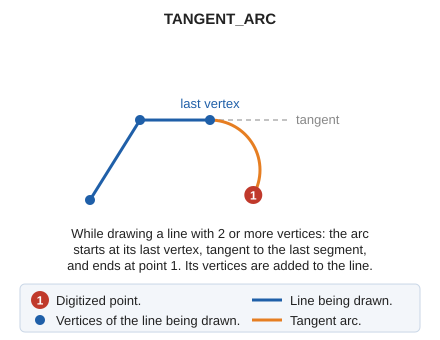

# TANGENT\_ARC
<!-- id: arco-tangente -->
<!-- origen: 8026376443d4fb943b366f4b23c59fa2ede9b9bb -->

Draw an arc tangent to the previous segment.

## Parameters

Does not accept parameters.

## Notes

The command only works while drawing a line with [LINE](/digi3d-ai/referencia/ventana-de-dibujo/ordenes/l/linea.md) that already has at least two vertices. The arc starts at the last vertex, tangent to the last segment, and ends at the point you digitize. Its vertices are added to the current line.

## Command characteristics

| Command type | [Interactive command](/digi3d-ai/referencia/ordenes/ordenes-interactivas.md) |
| :--- | :--- |
| Repeats automatically | No |
| Menu option | Draw/Arc tangent |
| Toolbar | Polylines |
| Extension | DigiNG.OrdenesStandard.dll |
| Implementation | Native |
| Related variables | [BEEPS](/digi3d-ai/referencia/ventana-de-dibujo/variables/p/pita.md) — enable or disable sounds |
| Related commands | [ARC](/digi3d-ai/referencia/ventana-de-dibujo/ordenes/a/arco.md) [LINE](/digi3d-ai/referencia/ventana-de-dibujo/ordenes/l/linea.md) [MULTIARC](/digi3d-ai/referencia/ventana-de-dibujo/ordenes/m/multiarco.md) |
| Internal name | {D5414D6A-1903-4120-8022-30BAFE0E1C60} |
