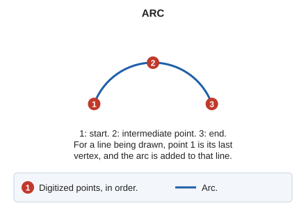

# ARC
<!-- id: arco -->
<!-- origen: fc14bfe2bd3fd95d7ca55676f34fd298db063b20 -->

Draw an arc in 3D space using three points you define.

## Parameters

Does not accept parameters.

## Notes

Specify the three points defining the arc graphically or enter their coordinates from the keyboard using [XY](/digi3d-ai/referencia/ventana-de-dibujo/ordenes/x/xy.md).

If you run the command while drawing an entity, specify only the arc's second and third points: its first point is the last point recorded in the entity.

## Command characteristics

| Command type | [Interactive command](/digi3d-ai/referencia/ordenes/ordenes-interactivas.md) |
| :--- | :--- |
| Repeats automatically | No |
| Menu option | Draw/Arc |
| Toolbar | Polylines |
| Extension | DigiNG.OrdenesStandard.dll |
| Implementation | Native |
| Related variables | [BEEPS](/digi3d-ai/referencia/ventana-de-dibujo/variables/p/pita.md) — enable or disable sounds |
| Related commands | [FILLET](/digi3d-ai/referencia/ventana-de-dibujo/ordenes/a/acuerdo.md) [TANGENT\_ARC](/digi3d-ai/referencia/ventana-de-dibujo/ordenes/a/arco-tangente.md) [MULTIARC](/digi3d-ai/referencia/ventana-de-dibujo/ordenes/m/multiarco.md) |
| Internal name | {3267A72F-6510-42bd-984F-1CC756AE8E45} |
