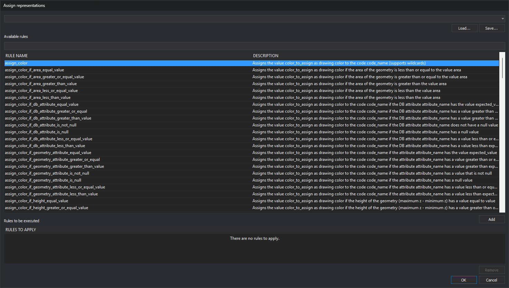
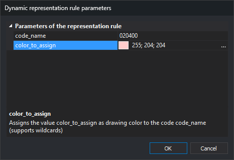

# ASSIGN\_REPRESENTATIONS
<!-- id: asignar-representaciones -->
<!-- origen: 9ff0c262123e1ec5b918fbd52cf4fe176c4bb12d -->

Assign a list of dynamic representation rules, defined in Python in the code table, to modify how geometries are displayed.

## Parameters

This command takes no parameters.

## Notes

The command opens **Assign representations**.



**Rules to be executed** starts empty. Previously assigned rules are not shown.

### Available rules

**Available rules** lists functions from the code table [Python environment](/digi3d-ai/referencia/editor-de-tablas-de-codigos/pestanas/entorno-python.md) code that meet both conditions:

* Decorated with `@dynamic_representation_rule()`.
* Have at least three parameters.

**Rule name** shows the function name. **Description** shows its docstring, or `None` if absent. If the code table defines no rules, the list indicates this.

Digi3D.AI calls each rule with three keyword arguments, so the first three function parameters must have these names:

* `geometry`: geometry to draw.
* `code_drawing`: code used to draw it.
* `representations`: representations calculated by preceding rules, or those of the code for the first rule.

The function returns the representation list used to draw the geometry. Parameters from the fourth onward belong to the rule. Write them as simple names without defaults or type annotations:

```python
@dynamic_representation_rule()
def mi_regla(geometry, code_drawing, representations, nombre_codigo, color_asignar):
    """Descripción que aparece en la columna Descripción"""
    ...
    return representations
```

### Filtering rules

The text box below **Available rules** filters by rule name. Enter words separated by spaces. Names must contain every word. Filtering is case-sensitive and does not search descriptions.

### Adding and removing rules

To add a rule to **Rules to be executed**, select it and click **Add**, or double-click it. Rules run in list order; the same rule can be added several times with different parameters.

Rules with their own parameters open **Dynamic representation rule parameters**.



The dialog lists one row per parameter under **Parameters of the representation rule**. Each row shows the exact function parameter name, such as `nombre_codigo`, and its value. The first row is initially selected. The lower pane shows the selected row name and rule docstring; Python does not provide separate parameter descriptions.

* Names containing lowercase `color` use a color picker, initially black. Click the button to the right of the value. The rule receives color as `"R G B"` text, for example `"255 0 0"`.
* Other parameters start empty and accept text. Names containing lowercase `codigo` always receive text, even if entirely numeric, such as `120400`. Other parameters receive integers or period-separated decimal numbers without leading zeros as numbers; any other value, such as `020`, is passed as text.

**OK** adds the rule and entered values to **Rules to be executed**, without validation: empty fields and codes absent from the code table are accepted. **Cancel** closes without adding it. The list shows the rule and values, for example `asignar_color({"color_asignar":"255 0 0", "nombre_codigo":"020"})`.

To remove a rule, select it in **Rules to be executed** and click **Remove**.

### Representation files

Save **Rules to be executed** in a `.representations` text file with one rule per line, exactly as displayed.

* **Save...** saves the list, proposing the first file in the top drop-down list.
* **Load...** opens a file and replaces **Rules to be executed** with its rules.
* The top drop-down list contains the last 10 loaded or saved files. Choosing one replaces the list with its content. Files that no longer exist are omitted.

Saving writes the file immediately; loading and saving update recent files even if you later click **Cancel**. Failure to create the file produces an error message.

To include a rule list in the code table, add the `.representations` file on the code table editor **Dynamic representations** tab. Activate it from **View/Dynamic representations** or with [DYNAMIC\_REPRESENTATION](/digi3d-ai/referencia/ventana-de-dibujo/ordenes/r/representacion-dinamica.md).

### Accepting and canceling

**OK** assigns **Rules to be executed** to the loaded code table and regenerates the view. An empty list disables dynamic representation. The assignment is not saved in the code table or drawing file.

**Cancel** closes without changing representation.

If a rule raises an exception or does not return a representation list, Digi3D.AI displays no message. That rule and subsequent rules are not applied to that geometry, which is drawn using results from earlier rules.

## Command characteristics

| Command type | Immediate command |
| :--- | :--- |
| Repeats automatically | No |
| Menu option | View/Dynamic representations/Assign representations manually... |
| Toolbar | _This command has no associated toolbar button_ |
| Extension | DigiNG.OrdenesStandard.dll |
| Implementation | Native |
| Related variables | [APPLY\_DYNAMIC\_REPRESENTATION\_DRAWING\_GEOMETRY](/digi3d-ai/referencia/ventana-de-dibujo/variables/a/aplicar-representacion-dinamica-geometria-dibujando.md) |
| Related commands | [DYNAMIC\_REPRESENTATION](/digi3d-ai/referencia/ventana-de-dibujo/ordenes/r/representacion-dinamica.md) |
| Internal name | {0023298C-F9CC-4EAD-838B-520AFD345D62} |
