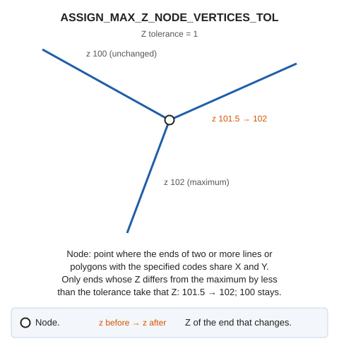

# ASSIGN\_MAX\_Z\_NODE\_VERTICES\_TOL
<!-- id: asignar-z-maxima-vertices-nodo-tol -->
<!-- origen: 8fdf38adc2e99c3b27c627cc9a33d1ebf9f8b883 -->

Locate all vertices meeting at a given node and assign the maximum Z at that node to each vertex whose Z differs from the node's maximum Z by less than the tolerance.

A node is a point where the ends of two or more lines or polygons with the specified codes share the same X and Y. The command modifies only the first and last vertices of each entity.

## Parameters

| Parameter number | Description | Optional |
| :--- | :--- | :--- |
| 1 | Z tolerance | No |
| 2 | One or more codes | No |

The command handles each entity independently: if Digi3D.AI rejects a modified entity, the command preserves the original entity. Entities accepted by Digi3D.AI are modified.

## Command characteristics

| Command type | [Immediate command](/digi3d-ai/referencia/ordenes/ordenes-no-interactivas.md) |
| :--- | :--- |
| Repeats automatically | No |
| Menu option | _This command has no associated menu option_ |
| Toolbar | _This command has no associated toolbar button_ |
| Extension | DigiNG.OrdenesTopologia.dll |
| Implementation | Native |
| Related variables | No related variables |
| Related commands | [ASSIGN\_MAX\_Z\_NODE\_VERTICES](/digi3d-ai/referencia/ventana-de-dibujo/ordenes/a/asignar-z-maxima-vertices-nodo.md) |
| Internal name | {80F18AE3-395E-4536-A2BC-2608D2B4888B} |
