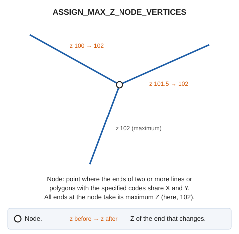

# ASSIGN\_MAX\_Z\_NODE\_VERTICES
<!-- id: asignar-z-maxima-vertices-nodo -->
<!-- origen: c105955313bc69536e5ea65c4e964219930305c8 -->

Locate all vertices meeting at a given node and assign the maximum Z at that node to each vertex.

## Parameters

| Parameter number | Description | Optional |
| :--- | :--- | :--- |
| 1 | One or more codes, separated by spaces | No |

## Notes

The command analyzes only visible entities with one of the codes passed as a parameter. Without codes, the command does nothing.

The command handles each entity independently: if Digi3D.AI rejects a modified entity, the command preserves the original entity. Entities accepted by Digi3D.AI are modified.

## Command characteristics

| Command type | [Immediate command](/digi3d-ai/referencia/ordenes/ordenes-no-interactivas.md) |
| :--- | :--- |
| Repeats automatically | No |
| Menu option | _This command has no associated menu option_ |
| Toolbar | _This command has no associated toolbar button_ |
| Extension | DigiNG.OrdenesTopologia.dll |
| Implementation | Native |
| Related variables | No related variables |
| Related commands | [ASSIGN\_MAX\_Z\_NODE\_VERTICES\_TOL](/digi3d-ai/referencia/ventana-de-dibujo/ordenes/a/asignar-z-maxima-vertices-nodo-tol.md) |
| Internal name | {F4EFC6BA-3505-41B2-B200-BD097D710042} |
